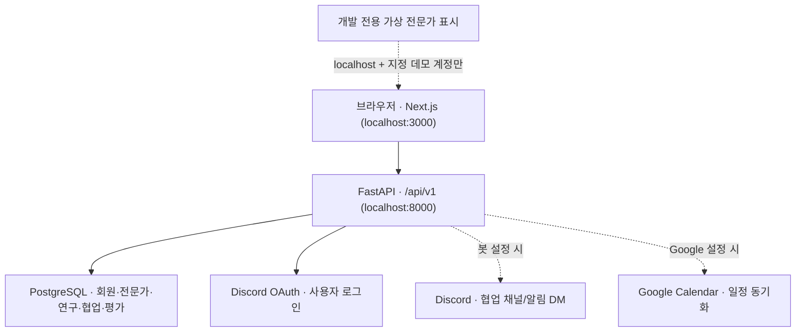

# WHAT THE LAB · LabBridge

**연구자가 필요한 AI 전문가를 찾고, 실제 연구 협업으로 연결하는 플랫폼**

> **문서 기준: 2026-10-31 · 현재 개발 브랜치 안내**  
> 이 README는 `feature/expert-search-dark-profile-first-20261031`의 실제 코드를 기준으로 작성했습니다. [PR #72](https://github.com/Lab-with-Al-platform/what_the-lab/pull/72)은 **Draft(검토 중)**이며, `develop`에 아직 병합되지 않았습니다. 코드 구현과 운영 배포·실사용 검증 완료는 구분해서 읽어 주세요.

## 먼저, 30초 요약

| 궁금한 것 | 답 |
|---|---|
| **무슨 서비스인가요?** | 연구자가 AI 전문가의 기술·포트폴리오·경력 정보를 비교하고 **직접 협업 요청**을 보내는 서비스입니다. |
| **이번에 무엇을 만들었나요?** | **전문가 검색 화면 → 상세 프로필 → 협업 요청 동선**을 새로 정리하고, **종료된 실제 협업의 평가·후기 시스템**을 연결했습니다. |
| **지금 어디까지 됐나요?** | 화면·API·DB 변경 코드와 자동 검증은 준비되어 있습니다. **Discord 실로그인 → 실제 협업 → 평가 저장·조회**의 최종 E2E 검수와 팀 공용 DB 적용은 별도입니다. |
| **어느 브랜치에서 보나요?** | `feature/expert-search-dark-profile-first-20261031`, [기존 PR #72](https://github.com/Lab-with-Al-platform/what_the-lab/pull/72). 새 PR을 만들 필요는 없습니다. |
| **어디서 시작하나요?** | 서버 실행 후 [`http://localhost:3000/experts`](http://localhost:3000/experts)에서 전문가 검색 화면을 확인하세요. |

**현재 우선 개발 시나리오는 ‘경로 B · 직접 요청’입니다.** 공개 프로젝트 모집·전문가 참여 신청·협업 후 정교한 성과 관리 등은 이번 작업의 주 흐름이 아닙니다. 기존 [MVP 범위 문서](docs/product/MVP_SCOPE.md)에는 더 넓은 초기 기획이 남아 있으므로, **실제 구현 범위는 아래 화면·코드 상태를 우선 확인**해 주세요.

---

## 1. 사용자가 실제로 이용하는 흐름

```text
[연구회원]                                     [AI 전문가]
    │                                              │
    ├─ ① 본인 연구 등록 (/my-research)               ├─ 본인 이력·기술·포트폴리오 등록
    │                                              │
    ├─ ② AI 전문가 검색 (/experts)                   ├─ 공개 프로필 설정
    │      └─ 기술·분야·협업 진행 상태로 필터링        │
    │
    ├─ ③ 전문가 상세 확인 (/experts/{id})
    │      ├─ 서비스 내 완료 협업 및 실제 평가
    │      ├─ 포트폴리오
    │      └─ 경력·학력·자격증·협업 조건
    │
    └─ ④ [협업 요청] ────────────────────────────────→ 요청 확인 / 수락·거절
                    │
              ⑤ 협업 시작 확정
                    │
              ⑥ 협업 공간 (/workspace)
                 일정·요청할 일·Discord 채널(설정 시)
                    │
              ⑦ 프로젝트 종료 상태 확정
                    │
              ⑧ 연구자 ↔ 전문가 양방향 평가
                    │
              ⑨ 검증된 평가만 전문가 공개 프로필에 반영
```

- **요청 시작 주체**: 연구회원이 자신의 **등록된 연구**를 선택하고 특정 AI 전문가에게 직접 요청합니다.
- **협업 시작**: 일반 요청은 전문가 수락 후 연구회원의 시작 확정이 필요합니다. **긴급 요청은 전문가가 수락하면 바로 시작**될 수 있습니다.
- **협업 공간**: 두 참여자에게 연결된 일정·할 일 및 기록을 사용합니다. 종료일이 지난 진행 중 협업의 완료 처리는 서버에서 관리합니다.
- **평가**: 화면에서 아무에게나 점수를 주는 방식이 아닙니다. **실제 협업 참여자와 종료 상태를 서버에서 확인**한 후에만 저장할 수 있습니다.

> 목록에서의 주요 행동은 **‘프로필 보기’**이며, 실제 **‘협업 요청’ 버튼은 전문가 상세 페이지**에 있습니다. 기존 로그인·요청관리·알림 흐름을 우회하지 않습니다.

## 2. 이번 PR에서 새로 달라진 점

### A. 전문가 찾기 — 밝은 화이트 대시보드

| 변경 사항 | 사용자 관점에서 달라진 점 | 주요 코드 |
|---|---|---|
| 전문가 검색 UI | 상단 소개 영역, 왼쪽 필터, 오른쪽 검색 결과의 **라이트 디자인** | [`expert-search.tsx`](frontend/src/components/expert-search.tsx), [`expert-search-hero.tsx`](frontend/src/components/expert-search-hero.tsx) |
| 검색 조건 | AI 수행 기술·연구 분야·진행 중 협업 상태, 검색어·정렬 | [`expert_search_store.py`](backend/app/expert_search_store.py) |
| 결과 비교 | 첫 번째 결과 강조, 카드형 전문가 목록, ‘프로필 보기’ | [`experts.py`](backend/app/routers/experts.py) |
| 상세↔목록 이동 | 상세에서 되돌아올 때 검색어·필터·펼쳐 본 결과 수 등을 복원 | [`expert-search-navigation.ts`](frontend/src/lib/expert-search-navigation.ts) |

- **실제 DB에 없는 전문가 수·평점·응답 시간을 임의로 표시하지 않습니다.**
- ‘진행 중인 협업 없음’은 **현재 여유가 있다고 보장하는 상태가 아닙니다**.
- 브랜치 이름에 `dark`가 남아 있지만 **현재 최종 선택된 화면은 밝은 B안 디자인**입니다.

### B. 전문가 상세 — 검색부터 협업 요청까지 연결

**경로:** `/experts/{id}`

| 탭·영역 | 보여주는 정보 |
|---|---|
| **이 서비스에서 한 연구 · 평가** | 실제 완료 협업 기록, 검증된 종합 점수 및 항목별 평가, 익명 후기 |
| **포트폴리오** | 전문가가 등록한 작업·프로젝트 자료 |
| **경력 · 학력 · 자격증** | 전문가가 등록한 경력·교육·자격 정보 |
| **협업 요청 패널** | 협업 조건·현재 진행 정보·연구회원의 요청 진입 버튼 |

모바일에서도 상세 정보를 살펴보고 협업 요청으로 이동할 수 있도록 구성했습니다. **비공개 연구 제목·요청 상대·내부 협의 내용은 공개 프로필의 평가 API로 반환하지 않도록 분리**했습니다.

**중요 — 가상 데이터와 실제 데이터의 차이**

- 로컬 개발 환경에는 `[데모] LLM 전문가`, `[데모] 의료 AI 전문가`, `[데모] 비전 전문가`, `[데모] 데이터 전문가` 4명의 시연용 프로필이 있습니다.
- `npm.cmd run dev`로 실행한 **localhost 개발 화면**에서만, 지정된 닉네임·소속에 한해 가상 협업·평가·포트폴리오·경력이 보강됩니다.
- 가상 정보에는 **`LOCAL DEMO` / `DEMO · 가상 평가`**가 표시됩니다. **DB에 실제 평가를 저장하거나 실제 협업 요청을 발송하지 않습니다.**
- Vercel/프로덕션 빌드와 일반 사용자 프로필에서는 이 가상 점수를 **실제 평가 집계에 포함하지 않습니다**.

자세히 보기: [검색 UI 설계·QA](docs/qa/expert-search-dark-premium-20261031.md) · [로컬 상세 시연 데이터](docs/qa/expert-profile-local-demo-20261031.md)

### C. 실제 협업 종료 후 평가·후기 — 신규 개발

**경로:** `/workspace` → **완료** 탭 → **협업 평가하기** → `/workspace/{id}#review`

| 조건/정책 | 현재 코드의 동작 |
|---|---|
| **누가 평가하나요?** | 해당 협업의 **연구회원 ↔ AI 전문가**, 각각 상대방을 평가 |
| **언제 가능한가요?** | 협업 상태가 `done` 또는 `ended_early`로 확정된 **종료 후 30일 이내**. 진행 중·시작 전 취소는 불가 |
| **무엇을 입력하나요?** | 역할에 맞는 **4가지 항목(각 1~5점)** + 선택 후기(최대 500자) |
| **중복 작성은요?** | **한 협업에서 참여자별 1회 제출**. 서버 권한 확인 + DB 고유 제약 |
| **수정은 되나요?** | 최초 제출 뒤 **48시간 안에 1회**. 이전 평가 변경 이력 보존 |
| **상대방의 평가는요?** | 프로젝트 종료 **7일 후** 협업 상세에서 당사자에게만 비공개 표시 |
| **전문가 공개 평점은요?** | **정상 완료(`done`)** 프로젝트에서 **연구회원이 전문가에게 제출한 평가**만 종료 7일 후 공개·집계 |
| **중도 종료는요?** | 양쪽이 피드백을 남길 수 있지만 **전문가 공개 평균에는 포함하지 않음** |
| **부적절한 후기는요?** | 후기 신고 → 운영자 검토 → 비공개/기각 등 처리. **신고만으로 자동 삭제되지 않음** |
| **알림은요?** | 자동 완료 시 사이트 알림, Discord Bot 설정이 있으면 DM에 평가 바로가기 |

**연구회원이 전문가를 평가하는 항목:** 전문성 · 소통 · 일정 준수 · 결과물 품질  
**전문가가 연구회원을 평가하는 항목:** 연구 준비도 · 소통 · 일정 협력 · 요구사항 명확성

**점수가 반영되는 과정**

```text
완료 협업(c.status = done)
     ↓ 참여자·작성 기간 검증 (FastAPI)
평가 작성 → PostgreSQL collaboration_review 테이블 저장
     ↓ 7일 공개 대기 + 공개 가능 여부 검사
실제 연구회원 평가 집계 (전문가 대상만)
     ↓
전문가 상세 화면에 평균 평점 · 세부 점수 · 익명 후기 표시

별도 경로: 후기 신고 → collaboration_review_report
                     ↓
                  관리자 검토
                     ↓
       비공개 결정 시 공개 점수에서 제외
```

**데이터베이스·서버 구성 요소**

- [`review_store.py`](backend/app/review_store.py): 참여자·기간·수정·공개·신고 검증 및 DB 처리
- [`routers/reviews.py`](backend/app/routers/reviews.py): 로그인 평가 API, 공개 평점 API, 관리자 처리 API
- [`collaboration-review-card.tsx`](frontend/src/components/collaboration-review-card.tsx): 실제 평가 작성·결과·신고 화면
- [`expert-review-summary.tsx`](frontend/src/components/expert-review-summary.tsx): 전문가 상세의 실제 평점·후기 표시
- [`admin/reviews/page.tsx`](frontend/src/app/admin/reviews/page.tsx): 운영자 신고 관리
- [`20261031_21 마이그레이션`](backend/migrations/versions/20261031_21_collaboration_reviews.py): 평가·신고 테이블과 알림 종류 추가

**평가 시스템의 설계와 검증 근거:** [100가지 예외·권한·데이터 점검 질문](docs/qa/verified-collaboration-reviews-100-questions-20261031.md) · [DB 적용 및 배포 인계서](docs/qa/verified-collaboration-review-release-20261031.md)

### D. LAB TRUST — 실제 협업 경험을 담는 플라스크 신뢰 지수 (2026-10-31)

[**LAB TRUST 제품·계량·운영 전략**](docs/qa/lab-trust-strategy-20261031.md) · [**100개 연쇄 검토 질문**](docs/qa/lab-trust-100-questions-20261031.md)

이번 브랜치에서 **당근 매너온도의 직관적인 신뢰 표현**을 연구 협업에 맞게 재설계했습니다. 전문가 목록의 강조 카드·일반 카드와 상세 프로필에 **유리 플라스크·액체 수위·숫자·표본 근거**를 연결했습니다. 점수는 실제 서버 데이터로 계산하며 사용자가 임의로 조정할 수 없습니다.

| 상황 | 플라스크 동작 | 의미 |
|---|---|---|
| 신규 전문가, 평가 0~2건 | **빈 플라스크 · 평가 축적 중** | 신규 회원이 불리해지지 않도록 임의 기본 점수 없음 |
| 정상 종료 연구회원 평가 ≥3건 + 서로 다른 연구회원 ≥2명 | **0~100 지수에 비례하여 액체 채움** | 전문성 30%·결과물 35%·소통 20%·일정 15%, 소표본 평활화 |
| 동일 연구회원과 반복 협업 | **최근 최대 3개 평가만 기여** | 평가 반복으로 무제한 점수 상승 억제 |
| 중도 종료, 숨김 후기, 종료 7일 미경과 | **계산에서 제외** | 기존 평가 공개·운영 정책 재사용 |
| 평가 API 오류 | **조회 불가** | 실패를 0점이나 미평가로 조작하지 않음 |
| 로컬 데모 전문가 | **LAB TRUST · 가상 미리보기** | 프론트엔드 디자인 시연 전용, 실제 신뢰 지수 아님 |

**중요한 한계:** 현재 협업 완료 상태는 일정에 따라 자동 전환될 수 있어 실제 연구 결과물까지 제3자가 증명한 것은 아닙니다. 따라서 LAB TRUST는 **플랫폼상 정상 종료된 협업과 연구회원 평가에 근거한 참고 지표**이며, 신원·학위·실력 인증을 의미하지 않습니다. **검색 순위 가중치로는 사용하지 않습니다.** 향후 양측 완료 확인·가짜 협업 탐지·분쟁 정책은 별도 승인과 개발이 필요합니다.

**구현**: [`reputation_store.py`](backend/app/reputation_store.py) · [`LAB TRUST SVG`](frontend/src/components/lab-trust-indicator.tsx) · [`백엔드 수학/권한 테스트`](backend/tests/test_reputation_store.py) · [`프론트 SVG 테스트`](frontend/tests/lab-trust.test.cjs)

## 3. 이번 변경 외에 기존 프로젝트에 있는 기능

이번 PR은 **전문가 화면 및 평가 흐름을 기존 서비스에 연결**한 작업입니다. 아래 기능들은 원래 프로젝트에 있던 코드·화면을 계속 사용합니다.

| 화면 | 경로 | 주요 역할 |
|---|---|---|
| 로그인·가입 | `/login`, `/signup` | Discord OAuth 로그인, 연구회원/전문가 유형 선택 및 가입 |
| 연구 등록·관리 | `/my-research` | 연구회원이 본인의 연구 등록·수정·관리 |
| 전문가 이력 관리 | `/my-career` | 전문가의 소개·기술·포트폴리오·경력 관리 |
| 협업 요청관리 | `/requests` | 보낸/받은 협업 요청, 수락·거절·취소·시작 처리 |
| 협업 공간 | `/workspace` | 확정 협업 목록, 일정·요청할 일·완료 기록 |
| 설정 | `/settings/profile` | 사용자 프로필 및 관련 설정 |
| 자유게시판 | `/community` | 커뮤니티 글 작성·조회·수정 등 (권한에 따라 다름) |
| FAQ | `/faq` | 사용법·요청·계정 관련 안내 |
| 사례·트렌드 | `/cases`, `/trends` | 연구 사례·기술 동향 콘텐츠 열람 |
| 관리자 | `/admin` | 운영 조회, 인사이트 관리 등 권한별 화면 |
| 후기 신고 관리 | `/admin/reviews` | **이번 PR에서 추가**, 공통 관리자 권한이 있는 경우만 표시 |

선택 연동인 **Discord 협업 채널/DM**과 **Google Calendar**는 서버 설정 및 권한이 갖춰진 환경에서만 사용됩니다. 게시판·인사이트 등의 실제 운영 데이터/기능 활성화 여부는 각 기능의 개발·배포 상태에 따라 달라집니다.

## 4. 기술 구조를 한 장으로 이해하기



| 폴더 | 담당하는 것 | 가장 먼저 볼 파일 |
|---|---|---|
| [`frontend/`](frontend/) | Next.js · React · TypeScript · Tailwind UI | [`src/components/expert-search.tsx`](frontend/src/components/expert-search.tsx) |
| [`backend/`](backend/) | FastAPI · 로그인/권한 · 요청/협업/평가 비즈니스 규칙 | [`app/main.py`](backend/app/main.py) |
| [`database/`](database/) | 로컬 Docker용 PostgreSQL 초기 스키마·기준 데이터 | [`init/`](database/init/) |
| [`backend/migrations/`](backend/migrations/) | Alembic 기반 개발 DB 스키마 변경 이력 | [`versions/`](backend/migrations/versions/) |
| [`docs/`](docs/) | 제품 결정·개발 안내·QA 결과 | [`docs/qa/`](docs/qa/) |
| [`ai/`](ai/) | 별도 AI 실험/자동화 코드 | [`ai/README.md`](ai/README.md) |

**중요한 데이터 원칙**

1. 사용자가 입력한 값은 **브라우저 → FastAPI 인증·권한·검증 → PostgreSQL**을 거쳐 저장됩니다. 클라이언트가 보낸 회원 역할·협업 대상 정보를 그대로 신뢰하지 않습니다.
2. `DATABASE_URL`이 있으면 **그 주소가 최우선**입니다. 없을 때만 `DB_HOST`/`DB_PORT`/`DB_NAME`/`DB_USER`/`DB_PASSWORD`를 사용합니다.
3. **개인 Docker DB와 팀 공용 Supabase DB는 서로 다른 데이터베이스**입니다. Docker에서 작성한 평가·시연 회원은 팀 공용 DB에 자동 복사되지 않습니다.
4. 가상 데모의 평점·후기는 **프론트엔드 표시 전용**이고, 실제 평가 데이터는 `collaboration_review`에서 관리합니다.

## 5. 팀원 로컬 실행 가이드 (Windows · PowerShell)

**필요한 것:** Git, Node.js(권장 22), Python 3.13 + `uv`, 그리고 로컬 DB를 쓸 경우 Docker Desktop/PostgreSQL 17.

### ① 현재 작업 브랜치 받기

**처음 저장소를 받는 팀원**

```powershell
git clone https://github.com/Lab-with-Al-platform/what_the-lab.git
cd what_the-lab
git switch --track origin/feature/expert-search-dark-profile-first-20261031
```

**이미 저장소를 받은 팀원 (프로젝트 루트)**

```powershell
git fetch origin
git switch feature/expert-search-dark-profile-first-20261031
git pull --ff-only origin feature/expert-search-dark-profile-first-20261031
```

로컬의 미커밋 작업이 있다면 먼저 저장/커밋한 뒤 브랜치를 이동하세요. **`develop`이나 `main`에 이 작업을 직접 커밋하지 않습니다.**

### ② `.env` 설정 (프로젝트 최상위 폴더)

```powershell
if (!(Test-Path .env)) { Copy-Item .env.example .env }
```

기존 `.env`가 이미 있다면 **덮어쓰지 않습니다**.

| 설정 | 필수 여부 | 설명 |
|---|---|---|
| `DISCORD_CLIENT_ID`, `DISCORD_CLIENT_SECRET` | 로그인에 필요 | 각 개발용 Discord OAuth 앱 정보 |
| `DISCORD_REDIRECT_URI` | 로그인에 필요 | 기본 예: `http://localhost:8000/api/v1/auth/discord/callback`. Discord Developer Portal 등록 주소와 정확히 일치해야 함 |
| `JWT_SECRET` | 로그인에 필요 | 본인 개발 환경의 임의·충분히 긴 서명 키 |
| `DATABASE_URL` 또는 `DB_*` | 데이터 기능에 필요 | 공용 개발 Supabase URL **또는** 개인 로컬 Docker DB |
| `NEXT_PUBLIC_APP_URL`, `CORS_ORIGINS` | 환경에 맞게 확인 | 로컬 기본 주소는 `http://localhost:3000` |
| `DISCORD_BOT_TOKEN`, `DISCORD_GUILD_ID` | 선택 | Discord 채널 및 DM 알림용. **OAuth 로그인 자체와는 별도** |
| `GOOGLE_*` | 선택 | Google Calendar 일정 연동용. 비어 있어도 기본 협업 공간 사용 가능 |

**개인 Docker DB로 실험한다면:** `DATABASE_URL`을 비워 두고 `DB_HOST=127.0.0.1`, `DB_PORT=5433`, `DB_NAME=labbridge`, `DB_USER=admin` 및 로컬 Docker에 맞는 `DB_PASSWORD`를 사용하세요. `.env.example`의 Supabase URL은 **실제 접속 정보가 아닌 예시**이므로 그대로 두면 안 됩니다.

**공용 Supabase를 사용한다면:** 실제 개발용 연결 설정을 DB 담당자에게 안전한 방법으로 받으세요. 공유 DB에는 임의로 SQL을 실행하지 않습니다. [공통 DB 운영 규칙](docs/development/SHARED_DATABASE_GUIDE.md)을 먼저 확인하세요.

### ③ DB 실행 또는 연결 확인

**개인 Docker DB 사용 시** 프로젝트 루트에서:

```powershell
docker compose up -d --wait postgres
docker compose ps
```

DB가 이미 있으면 같은 볼륨을 재사용합니다. **`docker compose down -v`와 볼륨 삭제 명령은 사용하지 마세요.**

**평가 시스템 DB 버전 확인 (읽기 전용):**

```powershell
docker compose exec postgres psql -U admin -d labbridge -c "SELECT version_num FROM public.insight_alembic_version;"
docker compose exec postgres psql -U admin -d labbridge -c "SELECT to_regclass('public.collaboration_review') AS review_table;"
```

평가 기능의 로컬 DB 기준 버전은 **`20261031_21`**입니다. **기존 Docker 볼륨에는 새 init SQL이 자동 재적용되지 않습니다.** 적용되지 않은 팀원은 [평가 마이그레이션 안내](docs/qa/verified-collaboration-review-release-20261031.md)의 백업·기준 버전·테이블 존재 여부 검사를 먼저 따르세요. 이미 적용된 DB라면 **다시 실행하지 않습니다.**

**공용 Supabase에는 위 Docker 안내를 적용하지 않습니다.** Alembic 변경은 DB 담당자가 실제 이력·백업·스테이징 검증 후 적용합니다.

### ④ 백엔드 시작 — 터미널 A

프로젝트 루트에서:

```powershell
cd backend
uv sync --locked
uv run uvicorn app.main:app --reload --port 8000
```

- 서버 상태: [`http://localhost:8000/api/v1/health`](http://localhost:8000/api/v1/health) → `{"status":"ok"}`
- API 목록: [`http://localhost:8000/docs`](http://localhost:8000/docs)
- 환경변수(특히 Discord·DB)를 바꾸었다면 **백엔드를 종료한 뒤 재시작**하세요.

### ⑤ 프론트엔드 시작 — 터미널 B (새 터미널)

프로젝트 루트에서:

```powershell
cd frontend
npm.cmd ci
npm.cmd run dev
```

- 메인: [`http://localhost:3000`](http://localhost:3000)
- 전문가 검색: [`http://localhost:3000/experts`](http://localhost:3000/experts)
- 협업 공간: [`http://localhost:3000/workspace`](http://localhost:3000/workspace) (로그인 필요)

기본 브라우저 API 주소는 `http://localhost:8000/api/v1`입니다. 별도 프록시가 필요한 경우에만 [커뮤니티 통합 실행 안내](docs/community/INSTALL_AND_QA.md)의 `frontend/.env.local` 설정을 참고하세요.

### ⑥ 가장 쉬운 기능 확인 순서

1. **로그인 없이** `/experts`에서 필터·검색·프로필 보기 동작을 확인합니다.
2. 로컬 DB에 데모 전문가가 있다면 4명의 **`LOCAL DEMO` 상세 탭**을 확인합니다. 없다면 실데이터 목록 또는 빈 상태가 정상일 수 있습니다.
3. **Discord 로그인** 후 역할을 선택하고, 연구회원은 연구를 등록하며 전문가는 프로필을 공개합니다.
4. 실제 연구회원이 실제 전문가에게 협업을 요청하고, 요청관리에서 수락·시작까지 진행합니다.
5. 협업이 정상 종료되어 `done`이 되면 `/workspace`의 완료 탭에서 **평가 작성·저장**을 시험합니다.
6. 공개 평점은 **종료 7일 후** 정책이 적용되므로 완료 직후 프로필에 나타나지 않아도 정상입니다.

> **시연용 데이터와 실사용 평가 테스트는 별개입니다.** 데모 전문가 4명의 가상 ‘완료 협업’으로는 진짜 평가 저장 테스트를 할 수 없습니다.

## 6. 자주 쓰는 API와 연결 지점

모든 경로는 `/api/v1`을 기준으로 합니다. **쓰기 API는 인증·권한/Origin 등 조건을 서버에서 검증**합니다.

| 기능 | 주요 API | 담당 파일 |
|---|---|---|
| 로그인/내 계정 | `GET /auth/me`, `/auth/discord/*` | [`routers/auth.py`](backend/app/routers/auth.py) |
| 전문가 목록/상세 | `GET /experts`, `GET /experts/{id}` | [`routers/experts.py`](backend/app/routers/experts.py) |
| 협업 요청관리 | `/researcher/requests`, `/expert/requests` | [`routers/collab_requests.py`](backend/app/routers/collab_requests.py) |
| 협업 공간 | `/workspace`, `/workspace/{id}` | [`routers/workspace.py`](backend/app/routers/workspace.py) |
| 내 평가 기회/상태 | `GET /reviews/mine`, `GET /reviews/collaborations/{id}` | [`routers/reviews.py`](backend/app/routers/reviews.py) |
| 평가 제출/수정 | `POST/PUT /reviews/collaborations/{id}` | [`review_store.py`](backend/app/review_store.py) |
| 공개 전문가 평점 | `GET /reviews/experts/{id}/summary` | [`review_store.py`](backend/app/review_store.py) |
| LAB TRUST 지수 (전문가 일괄/단일) | `GET /reviews/reputation?ids=...`, `GET /reviews/experts/{id}/reputation` | [`reputation_store.py`](backend/app/reputation_store.py) |
| 후기 신고·관리 | `/reviews/{review_id}/reports`, `/reviews/moderation/*` | [`routers/reviews.py`](backend/app/routers/reviews.py) |

## 7. 테스트 결과와 아직 확인해야 할 것

**기준: 2026-10-31, PR #72에 반영된 평가 시스템 코드**

| 항목 | 확인 상태 |
|---|---|
| 백엔드 평가 규칙·권한 단위 테스트 | **CI 통과** |
| PostgreSQL 17에서 평가 SQL 생성·제약·RLS 테스트 | **CI 통과** (격리 테스트 DB) |
| 평가 관련 프론트 테스트 · TypeScript · ESLint · Next.js 빌드 | **CI 통과** |
| Vercel 프론트 빌드 | **성공** — 실제 백엔드/DB 운영 검증과 다름 |
| 프론트엔드 **전체** 테스트 | **127개 중 125개 통과 / 2개 실패**. 기존 인사이트 이미지 개수·반응형 처리 기대값 불일치 |
| 사용자 개인 로컬 Docker DB | 평가 테이블 및 `20261031_21` 적용 확인. **다른 팀원/공용 DB 적용을 뜻하지 않음** |
| Discord 실제 로그인·요청·종료·평가 저장·조회 전 구간 E2E | **팀 실사용 검증 필요** |
| 실제 Discord DM·Google Calendar·다양한 화면 크기 실측 | **환경별 검증 필요** |
| `develop` 병합 및 운영 배포 | **미완료**. Draft PR 유지 |

팀원이 변경사항을 검토할 때는 `npm.cmd test`의 **전체 테스트 2건 실패를 숨기지 말고** 확인해 주세요. 별도로 이번 작업의 직접 연동 테스트도 실행할 수 있습니다.

**프론트 검증 — `frontend/` 터미널**

```powershell
npm.cmd test
npx.cmd tsc --noEmit
npm.cmd run lint
npm.cmd run build
```

**백엔드 평가 테스트 — `backend/` 터미널**

```powershell
uv run pytest -q tests/test_collaboration_reviews.py
```

빌드 중에는 실행 중인 Next.js 개발 서버를 종료하는 편이 안전합니다. 전체 평가 관련 CI 설정은 [`.github/workflows/collaboration-reviews-ci.yml`](.github/workflows/collaboration-reviews-ci.yml)에서 확인할 수 있습니다.

## 8. 팀원이 함께 확인해야 할 것 (PR 리뷰 체크리스트)

- [ ] **검색 → 상세 → 직접 요청** 흐름이 기존 로그인·연구 등록·요청관리와 끊김 없이 이어지는가?
- [ ] 연구자/전문가 실제 계정 각각에서 **협업 시작 → 종료 → 평가 제출**이 동작하는가?
- [ ] 진행 중/취소된 협업과 제3자의 **평가 작성이 서버에서도 차단**되는가?
- [ ] 30일 작성 기한·48시간 수정·7일 공개 대기·중도 종료 비공개 집계가 정책대로 작동하는가?
- [ ] 공개 후기에서 **연구 제목·상대방 신원·비공개 연구 정보**가 노출되지 않는가?
- [ ] 실제 DB 변경 이력·백업·적용 대상이 확인됐는가? **로컬 DB와 공용 Supabase를 혼동하지 않았는가?**
- [ ] 390px / 768px / 1440px 화면·키보드 접근·에러/빈 상태까지 확인했는가?
- [ ] 전체 테스트 실패 2건의 처리와 Discord·운영자·알림 실검증 결과를 리뷰에 기록했는가?

## 9. 브랜치·PR 협업 규칙

```text
main          서비스의 안정 기준
  ↑
develop       팀이 리뷰 후 기능을 통합하는 브랜치
  ↑
feature/expert-search-dark-profile-first-20261031
              이번 전문가 검색·프로필·종료 평가 작업본
              └── PR #72 → develop (현재 Draft, 미병합)
```

- **이 기능 때문에 새 PR을 만들 필요가 없습니다.** 같은 브랜치에 푸시한 변경은 기존 [PR #72](https://github.com/Lab-with-Al-platform/what_the-lab/pull/72)에 자동 반영됩니다.
- **`develop`/`main`에 직접 수정하거나 강제 push하지 않습니다.**
- 병합 전 `develop`의 최신 변경과 충돌·호환성 확인, DB 담당자 승인, 기능/보안/반응형 테스트를 거쳐야 합니다.
- 팀 합의·범위 변경과 담당 간 코드 영향은 [Git 팀 규칙](docs/development/TEAM_WORKFLOW.md) 및 [의사결정 로그](docs/product/03_DECISION_LOG.md)를 함께 확인합니다.

## 10. 문제를 만났을 때 먼저 볼 곳

| 증상 | 우선 확인 |
|---|---|
| 로그인 버튼을 눌러도 Discord 인증 실패 | `DISCORD_CLIENT_ID`/`DISCORD_CLIENT_SECRET`/`DISCORD_REDIRECT_URI`, Developer Portal 등록 주소, 백엔드 재시작 |
| Docker는 켰는데 API DB 조회 실패 | `DATABASE_URL` 우선순위, 실제 연결 대상, PostgreSQL 실행 상태, DB 스키마 이력 |
| 전문가 4명 시연 정보가 안 보임 | localhost 개발 모드인지, DB에 해당 데모 계정이 있는지, 닉네임·소속이 일치하는지 |
| 프로필에 실제 평점이 없음 | 검증된 완료 평가가 0건인지, 종료 7일이 지났는지, `review` 테이블이 준비됐는지 |
| 평가 저장 버튼이 없음/비활성 | 실제 협업 당사자 계정인지, 서버 상태가 `done`/`ended_early`인지, 30일 기한/기존 평가 여부 |
| 평가/관리자 API에서 403·404 | 로그인 쿠키, 참여자·공개 여부·관리자 권한, 허용 Origin 설정 |
| 새 테이블 SQL 재실행에서 오류 | **재실행 중지**. 기존 테이블·버전 확인 후 [DB 적용 안내](docs/qa/verified-collaboration-review-release-20261031.md) 참조 |

---

## 참고 문서 모음

| 문서 | 읽으면 알 수 있는 것 |
|---|---|
| [전문가 검색 라이트 B안 UI·QA](docs/qa/expert-search-dark-premium-20261031.md) | 디자인 선택 근거·검색 필터·데이터/권한 경계 |
| [전문가 상세 LOCAL DEMO](docs/qa/expert-profile-local-demo-20261031.md) | 로컬 가상 전문가 4명·3개 탭·실제 데이터 분리 |
| [평가 시스템 배포·DB 안내](docs/qa/verified-collaboration-review-release-20261031.md) | 실제 평가 정책·변경 파일·DB 적용 절차·운영 검토 |
| [100개 평가 예외·검토 질문](docs/qa/verified-collaboration-reviews-100-questions-20261031.md) | 권한·중복·공개·신고·DB·UI 등 심층 검토 |
| [공통 Supabase·Docker DB 가이드](docs/development/SHARED_DATABASE_GUIDE.md) | `DATABASE_URL` 우선순위·데이터 보호·팀 DB 협업 |
| [Discord 협업 채널 설정](docs/development/SETUP_DISCORD_COLLAB_CHANNEL.md) | 협업 전용 Discord 채널 준비 |
| [커뮤니티 통합·설치 안내](docs/community/INSTALL_AND_QA.md) | 게시판·FAQ, 공통 API 설정 및 검증 |
| [제품 의사결정 기록](docs/product/03_DECISION_LOG.md) | 장기 범위와 기존 팀 결정·변경 배경 |

**이 문서의 한 줄 결론:** 현재 브랜치에는 **연구자가 AI 전문가를 검색해 직접 협업을 요청하는 흐름**과 **실제 종료 협업 기반 양방향 평가 시스템**의 코드가 준비되어 있습니다. **운영 검증·공용 DB 적용·`develop` 병합은 별도의 완료 조건**입니다.
