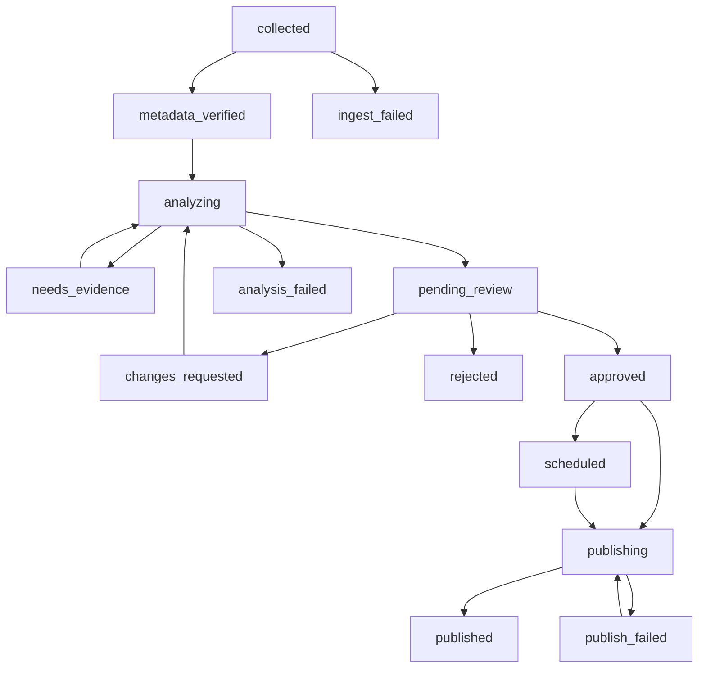

# 05. API·권한·상태 머신·게시 일관성

> URL은 **제안**. 기존 API 라우트가 있으면 확장하고, 관리자 인증/응답 규약을 그대로 사용.

## API

| Method | Route | 권한 | body/query | 결과·실패 |
|---|---|---|---|---|
| GET | `/api/admin/research-cases` | admin/reviewer | status,domain,score,sort,page | pagination, counts; 401/403 |
| GET | `/api/admin/research-cases/{id}` | admin/reviewer | - | Case Sheet, claims, source links, keyword links, revisions |
| PATCH | `/api/admin/research-cases/{id}` | admin/editor | `revision`, `version`, patch | 새 revision/409 충돌 |
| POST | `/api/admin/research-cases/{id}/request-evidence` | admin/reviewer | reason | needs_evidence |
| POST | `/api/admin/research-cases/{id}/reanalyze` | admin/editor | strategy, reason | async job id; 기존 승인 무효 처리 정책 필요 |
| POST | `/api/admin/research-cases/{id}/approve` | admin/publisher | revision_id, version, schedule_at?, keyword_links, rationale | approved/scheduled, 409 if stale |
| POST | `/api/admin/research-cases/{id}/reject` | admin/reviewer | reason(required) | rejected |
| POST | `/api/admin/research-cases/{id}/reopen` | admin | reason | draft/needs_review |
| POST | `/api/admin/research-cases/{id}/cancel-schedule` | admin/publisher | reason | approved_unscheduled |
| POST | `/api/admin/research-cases/collect` | admin/operator | config_ref? | run id (safeguarded queue) |
| GET | `/api/admin/research-runs` | admin/operator | status,page | counters and failure details |
| GET | `/api/insights` | public | 기존 필터 | published only |
| GET | `/api/insights/{slug}` | public | - | published only, source links and verified tech tags |

모든 POST 변경 요청에는 CSRF 대응(세션 기반일 경우), 서버 RBAC, rate limit, 요청 감사 로그. `Idempotency-Key`(승인/예약 게시)와 optimistic `version` 적용. 역할명/권한 범위는 실제 프로젝트 RBAC에 매핑.

## 상태 머신



`ineligible`, `duplicate_suppressed` 등은 별도 terminal reason으로 기록. `approved` 이후 콘텐츠 변경 시 기존 승인 스냅샷을 유지하거나 명시적으로 승인 취소 후 재검토(권장), **승인된 revision과 실제 게시 revision의 일치**를 확인.

## 전이 가드

- `pending_review → approved`: 관리자 권한, 증거 게이트 통과, 출처/저작권 확인, 공개 본문 revision 고정, 검색 키워드 ID verified, 제목/slug 검사, 필수 사실 근거.
- `approved → scheduled`: schedule_at 검증 (UTC 보관, KST 노출) + 즉시 게시 시 now.
- `scheduled → publishing`: worker는 승인 스냅샷만 읽고 edit 금지. `published`이면 재발행 금지.
- `publish_failed → publishing`: 동일 revision/동일 idempotency key 기반 재시도, 이전 insight 생성 여부 확인.
- 게시 후 정정: 기존 insight에 버전 추가/정정 이력, 공개 사용자에게 정정일 표시(정책 확정 필요).

## 게시 서비스 pseudocode

```python
def publish(candidate_id, approved_revision_id, key):
    with db.transaction():
        candidate = db.lock_candidate(candidate_id)
        if candidate.status == 'published':
            return candidate.published_insight_id
        assert candidate.status in ('approved','scheduled','publish_failed')
        assert candidate.approved_revision_id == approved_revision_id
        assert candidate.evidence_gate == 'pass'
        assert candidate.approved_by is not None
        assert no_unverified_expert_keyword_ids(candidate)
        existing = db.find_insight_by_candidate(candidate.id)
        insight = existing or db.create_insight_from_revision(candidate, approved_revision_id)
        db.link_verified_keywords(insight, candidate)
        db.mark_candidate_published(candidate, insight)
        db.record_publication_attempt(key, 'succeeded', insight.id)
        return insight.id
```

**실제 DB 트랜잭션/unique 키 및 워커 동시성에 맞춰 구현.** UI에서 임의 status 요청으로 승인 우회 불가.

## 공통 오류 계약

`{ "code":"CONFLICT_REVISION", "message":"...", "request_id":"...", "details":{} }` 형식은 제안. 400 invalid payload; 401 unauthenticated; 403 unauthorized; 404 hidden/unfound; 409 stale revision/illegal transition/duplicate; 422 failed validation; 429 rate limited; 500 internal. 비공개 논문/출처 내용은 공개 오류 로그에 출력 금지.

## E2E 승인 흐름

후보 GET → 상세 GET → 수정 PATCH(revision) → 출처/근거 검토 → approve POST(revision/version) → schedule → worker publish → 공개 insight GET → CTA 클릭 → 기존 expert search에 Master ID 전달.
