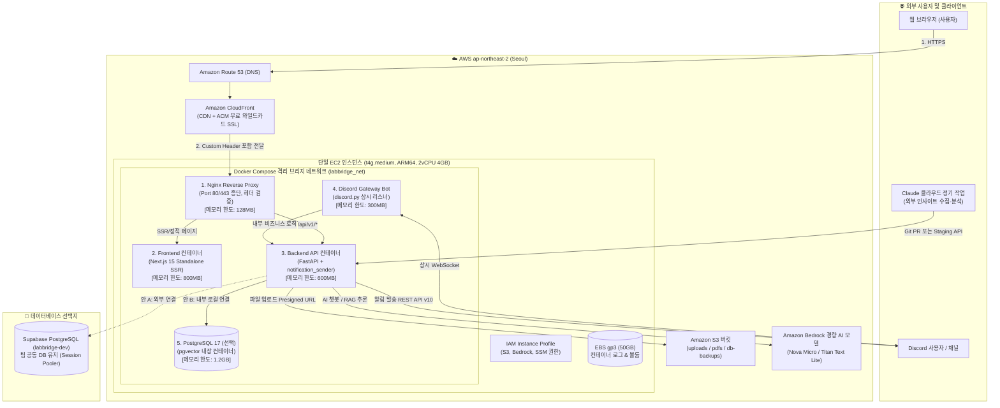

# 02. 최종 권장 아키텍처 설계 (Recommended Architecture) — 개정판

> **상태**: `[PROPOSED]`  
> **리전**: AWS 서울 리전 (`ap-northeast-2`)  
> **핵심 목표**: 월 $50 내외의 초저비용 운영, Discord Gateway 상시 연결과 알림의 안정적 분리, 컨테이너별 메모리 제한을 통한 단일 인스턴스 OOM 방지.

---

## 1. 전체 아키텍처 구성도

---

## 2. Docker Compose 컨테이너 자원 분배 및 안전 장치 (OOM 방지)

단일 EC2 호스트(`t4g.medium` 4GB RAM)에서 특정 컨테이너의 메모리 누수로 인해 전체 서버가 다운(OOM Crash)되는 사고를 방지하기 위해 엄격한 리소스 한도(Resource Limit)를 설정합니다.

### 2.1 컨테이너별 메모리/CPU 할당 명세

| 서비스명 | 권장 메모리 Limit | 예약 메모리(Reservations) | CPU Limit | 재시작 정책 | 로깅 제한 |
|---|---|---|---|---|---|
| **nginx** | `128 MB` | `64 MB` | 0.25 vCPU | `unless-stopped` | 10MB x 3개 |
| **frontend** | `800 MB` (최대 1GB) | `384 MB` | 0.75 vCPU | `unless-stopped` | 10MB x 3개 |
| **backend** | `600 MB` (최대 768MB) | `256 MB` | 0.75 vCPU | `unless-stopped` | 10MB x 3개 |
| **discord-bot** | `300 MB` (최대 384MB) | `128 MB` | 0.25 vCPU | `unless-stopped` | 10MB x 3개 |
| **postgres** (안 B 적용 시) | `1.2 GB` | `512 MB` | 0.50 vCPU | `unless-stopped` | 10MB x 3개 |
| **OS 및 시스템 버퍼** | 약 `1.0 GB` 확보 | — | — | — | — |
| **합계 (Total)** | **약 2.9 GB ~ 3.5 GB / 4.0 GB** (완전 안전 영역 유지) | — | — | — | — |

> [!TIP]
> **안 A (Supabase 유지 시)의 이점**:
> PostgreSQL 컨테이너(`1.2GB`)가 빠지므로, 더 저렴한 **`t4g.small` (2GB RAM, 월 약 $13)**으로도 인프라를 충분히 구동할 수 있어 비용을 극대화하여 절감할 수 있습니다.

---

## 3. 컨테이너 장애 복구 및 생명주기 관리

1. **Graceful Shutdown**:
   - `stop_grace_period: 30s`를 지정하여 백엔드 비동기 워커가 진행 중인 Discord 알림 발송이나 DB 트랜잭션을 안전하게 커밋하고 종료할 수 있도록 보장합니다.
2. **Discord Gateway Bot 자동 재연결**:
   - Discord 네트워크 일시 단절 시 `discord.py` 라이브러리의 지수 백오프 자동 재연결(`reconnect=True`)이 작동하며, 치명적 에러로 종료되더라도 Docker의 `restart: unless-stopped` 정책에 의해 3초 내에 자동 재부팅됩니다.
3. **로그 로테이션 (Log Rotation)**:
   - 모든 컨테이너에 `json-file` 드라이버와 `max-size: "10m"`, `max-file: "3"`을 강제하여 Docker 로그가 디스크(EBS)를 가득 채우는 사고를 원천 방지합니다.
4. **Health Check 구성**:
   - Nginx: `curl -f http://localhost/ || exit 1`
   - Backend: `curl -f http://localhost:8000/api/v1/health || exit 1`
   - Frontend: `curl -f http://localhost:3000/ || exit 1`
