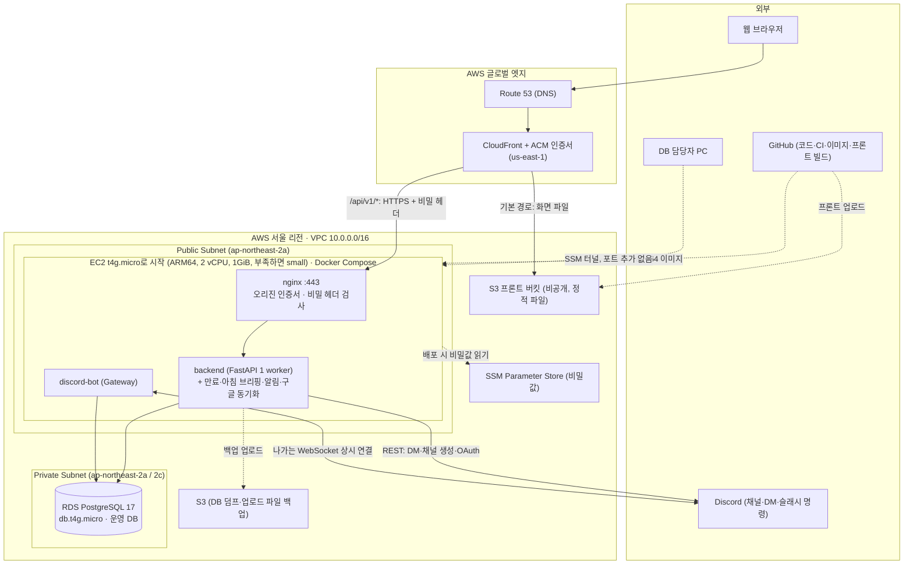

# 02. 최종 권장 아키텍처 (Recommended Architecture) — v4

> **상태**: `[PROPOSED]` (AWS 통합 배포 방향은 `[DECIDED]`)
> **리전**: AWS 서울 (`ap-northeast-2`)
> **핵심 목표**: 월 $50 내외, 디스코드 봇·알림·예약 작업을 한 곳에서 같은 코드 버전으로 운영, 프론트는 S3 정적 배포, 운영 DB는 비공개 RDS로 분리.

---

## 1. 전체 구성도

### 1.1 그림을 읽는 법
- **사용자 요청 길**: 브라우저 → Route 53(주소 찾기) → CloudFront(HTTPS 접점) → 화면 파일은 S3에서, `/api/v1`은 EC2 nginx를 거쳐 backend로.
- **운영 DB 접속 길**: DB 담당자 PC → SSM 터널 → EC2 → RDS. RDS 자체는 비공개 그대로예요 ([03](03-network-security.md) 2.3절).
- **디스코드 길**: 봇은 사용자 요청을 받지 않아요. 봇이 먼저 디스코드에 **연결을 걸어 두고** 명령·버튼 이벤트를 받아요. 그래서 인바운드 포트가 필요 없어요.
- **DB 길**: backend와 discord-bot이 **둘 다 RDS에 직접** 연결해요 (`backend/app/discord_gateway.py`가 `app.db.get_connection` 사용 `[CONFIRMED]`). 봇이 backend를 HTTP로 부르는 구조가 아니에요.
- **개발 DB는 그림에 없어요**: 팀 개발은 계속 공용 Supabase `labbridge-dev`를 쓰고, 운영 RDS와 섞지 않아요.

---

## 2. 컨테이너 자원 한도 (t4g.small 2GiB 기준, micro는 2-1절)

| 서비스 | 메모리 Limit | 로컬 실측(유휴) | CPU Limit | 재시작 | 로그 |
|---|---|---|---|---|---|
| nginx | 64 MB | 14.7 MiB | 0.25 | `unless-stopped` | 10MB × 3 |
| backend | 512 MB | 104.6 MiB | 0.75 | `unless-stopped` | 10MB × 3 |
| discord-bot | 256 MB | 79.7 MiB | 0.25 | `unless-stopped` | 10MB × 3 |
| **합계** | **832 MB** | **199 MiB** | — | — | — |
| OS·Docker 여유 | 약 1.2 GB | — | — | — | — |

- 실측값은 2026-11-05 로컬(x86_64) 기동 직후 한 시점이에요 `[LOCAL_VERIFIED]`. 동시 접속 부하는 `[UNVERIFIED]`.
- **강사님 권장 (2026-11-10)**: "micro로 한번 테스트해 보라." → **팀 결정 (2026-11-13)**: 첫 배포는 **`t4g.micro`로 시작**해요. 배포 후 **2주는 테스트 기간**이고, 회원을 모집해도 **50명 내외**로 예상해요. ALB는 **이용자 수 추이를 보고 정하는 향후 계획**이에요. micro 한도는 아래 2-1절이에요.
- **크기 조정 기준**: micro로 시작해서, 2-1절 기준에 해당하면 `t4g.small`(이 표의 한도)로 올려요. 인스턴스 종류 변경은 몇 분 정지가 필요해요.
- **빌드는 서버에서 하지 않아요**: GitHub Actions에서 arm64 backend 이미지를 만들어 레지스트리에 올리고, 프론트 정적 파일은 S3에 올려요. EC2는 이미지를 받기만 해요.

### 2-1. `t4g.micro`(1GiB)로 시작할 때 (2026-11-13 팀 결정)

small 기준 한도 합계(832MB)를 그대로 쓰면 OS·Docker가 쓸 메모리가 200MB도 안 남아요. 그래서 micro에서는 한도를 줄이고 **스왑(swap) 1GB**를 붙여요.

| 서비스 | micro 메모리 Limit | 로컬 실측(유휴) |
|---|---|---|
| nginx | 48 MB | 14.7 MiB |
| backend | 384 MB | 104.6 MiB |
| discord-bot | 192 MB | 79.7 MiB |
| **합계** | **624 MB** | **199 MiB** |
| OS·Docker 여유 | 약 400 MB + 스왑 1GB | — |

- 한도 값은 실측(유휴)의 약 2.5~3.5배로 잡은 **시작값**이에요 `[PROPOSED]`. 테스트 기간 기록을 보고 조정해요.
- **스왑**: 디스크(EBS) 일부를 비상용 메모리로 써요. 순간적으로 메모리가 모자랄 때 서버가 꺼지는 것을 막아 주지만, 계속 쓰이면 느려져요. 추가 비용은 없어요(EBS 30GB 안).
- **CPU**: micro와 small은 둘 다 vCPU 2개예요. 다만 평소 쓸 수 있는 기준 CPU가 micro는 10%, small은 20%라서, **CPU 크레딧**을 small보다 빨리 써요 `[UNVERIFIED: AWS 인스턴스 표 재확인]`.

**2주 테스트 기간에 small로 올리는 기준** (하나라도 해당하면 올려요, 월 +$7.59):
1. 컨테이너 OOM 재시작이 한 번이라도 생길 때
2. 메모리 사용이 한도의 80%를 넘는 상태가 자주 보일 때
3. 스왑 사용량이 100MB 이상인 상태가 하루 넘게 계속될 때
4. CPU 크레딧 잔액이 계속 줄어 바닥에 가까워질 때
5. API 응답이 눈에 띄게 느려졌다는 베타 사용자 의견이 나올 때

- small로 올리는 방법: EC2를 멈추고 인스턴스 종류만 바꾼 뒤 다시 켜요(몇 분 정지). 데이터는 RDS와 EBS에 있어서 그대로예요. 한도는 위 2절 small 값으로 되돌려요.
- 50명 내외 규모에서는 micro로 버틸 가능성이 높다고 봐요 `[ESTIMATE]`. 그래도 실측 전이라 확정은 아니에요.

---

## 3. 단일 실행 원칙 (가장 중요)

| 무엇 | 운영에서 동시에 몇 개? | 이유 |
|---|---|---|
| backend 컨테이너 | **1개** | `lifespan`에서 만료·아침 브리핑·알림·구글 동기화 4개 작업이 시작돼요 (`backend/app/main.py`) |
| Uvicorn worker | **1개** (`--workers 1`) | 위와 같은 이유 |
| discord-bot 컨테이너 | **1개** | 같은 토큰으로 두 개가 접속하면 이벤트를 둘 다 받을 수 있어요 |

- 알림 발송·구글 동기화·협업 채널 생성은 이미 `FOR UPDATE SKIP LOCKED`로 중복을 막아요 `[CONFIRMED]` (`notification_sender.py`, `google_sync.py`, `collab_channel.py`).
- 아침 브리핑은 "오늘 이미 돌았는지"를 프로세스 메모리(`LAST_RUN`)로 판단해요 (`task_daily.py`). 그래서 backend가 두 개 뜨면 브리핑이 두 번 나갈 수 있어요.
- **전환하는 날에는 Render의 backend·봇을 먼저 끄고 EC2를 켜요** ([05](05-discord-integration.md) 4절).

---

## 4. 장애 복구와 생명주기

1. **정상 종료**: `stop_grace_period: 30s`로 진행 중인 DB 작업과 DM 발송을 마무리할 시간을 줘요.
2. **봇 재연결**: `discord.py` 자동 재연결 + Docker `restart: unless-stopped`.
3. **로그 크기 제한**: 모든 컨테이너 `json-file`, `max-size: 10m`, `max-file: 3`.
4. **헬스체크**: nginx `/healthz`, backend `/api/v1/health`. 헬스체크 통과가 로그인·협업·디스코드 동작 성공을 뜻하지는 않아요.
5. **EC2가 통째로 죽으면**: 새 EC2를 띄우고 Elastic IP를 다시 붙이면 돼요. DB는 RDS에 있으니 서버를 잃어도 데이터는 남아요 ([10](10-operations-runbook.md)).

---

## 5. 왜 이 정도 규모인가? (과하지도 모자라지도 않게)

- **넣지 않은 것**: ALB, NAT Gateway, ECS/Fargate, Multi-AZ RDS, Redis. 지금 트래픽에는 필요 없고 월 수십 달러가 더 들어요.
- **꼭 넣은 것**: 관리형 운영 DB(RDS), 마이그레이션 우선 배포 절차, 단일 실행 원칙, 백업 복원 테스트. 사용자가 적어도 데이터 손실과 중복 알림은 바로 신뢰 문제가 되기 때문이에요.
- **프론트를 S3로 뺀 이유 (v4)**: 화면 접속이 몰려도 EC2의 API와 봇이 영향을 받지 않아요. 비용 절약은 EC2를 작게 줄일 때 생겨요.
- **ALB (강사님 제안, 2026-11-10)**: 사용자가 늘 때를 대비해 ALB를 앞에 두는 구성을 권하셨어요. 월 약 $25가 더 들고, 서버를 2대 이상으로 늘리려면 API와 예약 작업·봇을 먼저 나눠야 해요. **팀 결정 (2026-11-10): 베타 운영 기간에는 ALB 없이 운영**하고, 그동안 API와 예약 작업·봇 분리를 준비해요 ([16](16-api-worker-split.md)). 그리고 정식 공개나 트래픽 증가 때 서버 분리와 함께 다시 검토해요 ([15](15-instructor-feedback-20261110.md) 2-2절, [08](08-cost-estimate.md) 2.1절).
- **나중에 바꿀 신호**: 동시 접속 증가로 `t4g.medium`도 모자라거나, 다운타임을 줄여야 할 때 → ALB + 2대 또는 ECS 검토 ([01](01-architecture-options.md)).
