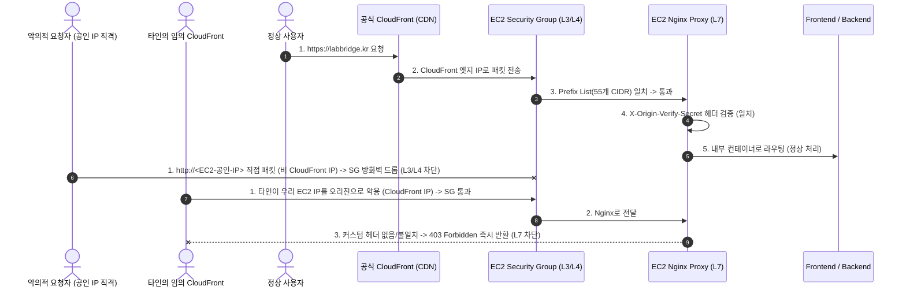

# 03. 네트워크 및 보안 아키텍처 (Network & Security)

> **상태**: `[PROPOSED]`  
> **핵심 원칙**: 최소 권한의 법칙(Principle of Least Privilege), 다계층 심층 방어(Defense in Depth), 인프라 비용과 보안성 간의 최적 균형 유지.

---

## 1. VPC 및 서브넷 구성

### 1.1 Phase 1 (초기 실속형 네트워크)

초기 비용 절감을 위해 고가의 NAT Gateway(월 $32+)를 도입하지 않고 단일 Public Subnet 기반으로 시작합니다.

- **VPC CIDR**: `10.0.0.0/16`
- **Public Subnet**: `10.0.1.0/24` (AZ: `ap-northeast-2a`)
- **인터넷 게이트웨이 (IGW)**: 외부 인터넷과의 인바운드/아웃바운드 통신 제공.
- **탄력적 IP (Elastic IP)**: EC2 인스턴스에 고정 공인 IP 1개 할당 (CloudFront 오리진 연결용).

### 1.2 Phase 2/3 (확장 시 표준 3계층 네트워크)

RDS 도입 및 ECS Fargate 확장 시 다음과 같은 표준 다중 AZ 서브넷으로 확장합니다:

- **Public Subnet (2개 AZ)**: ALB, NAT Gateway (또는 fck-nat) 배치
- **Private App Subnet (2개 AZ)**: ECS Fargate 컨테이너 태스크 배치
- **Private DB Subnet (2개 AZ)**: RDS PostgreSQL Multi-AZ 클러스터 배치

---

## 2. 보안 그룹 (Security Group) 설계

### 2.1 EC2 보안 그룹 (`sg-whatthelab-ec2`)

| 트래픽 유형  | 프로토콜 | 포트        | 소스 (Source)                                    | 설명                                   |
| ------------ | -------- | ----------- | ------------------------------------------------ | -------------------------------------- |
| **Inbound**  | TCP      | `80`, `443` | `pl-xxxxxxxx` (AWS 관리형 CloudFront Origin-facing Prefix List) | CloudFront 엣지 IP 대역만 허용 (추가 비용 $0) |
| **Inbound**  | TCP      | `22`        | **차단 권장** (또는 관리자 특정 고정 IP만 허용)  | SSH 원격 접속 (SSM 세션 매니저 우선)   |
| **Outbound** | ALL      | ALL         | `0.0.0.0/0`                                      | 외부 API(Discord, Bedrock, S3 등) 통신 |

> [!IMPORTANT]
> **AWS 관리형 Prefix List 적용 및 가중치(Weight) 고려사항**:
> 1. **EC2 직접 바인딩 지원**: CloudFront 오리진 대역 Prefix List (`com.amazonaws.global.cloudfront.origin-facing`)는 **ALB나 WAF 없이도 EC2 Security Group 인바운드 규칙의 소스로 직접 지정할 수 있습니다** (추가 비용 $0).
> 2. **규칙 가중치(55 소모)**: 본 Prefix List는 보안 그룹 규칙 가중치(Quota)를 **55개** 소모합니다. AWS 기본 보안 그룹당 인바운드 규칙 한도는 **60개**이므로, Prefix List를 등록하면 해당 보안 그룹에 추가 가능한 규칙은 최대 5개로 제한됩니다. 따라서 웹 포트(80/443)와 관리자용 규칙 외의 불필요한 규칙 등록을 엄격히 배제해야 합니다.
> 3. **SSH 포트(22) 완전 차단의 권장**:
>    EC2 인스턴스에 SSH 포트를 공인 인터넷에 개방하는 대신, **AWS Systems Manager (SSM) Session Manager**를 사용합니다. SSM을 사용하면 22번 포트를 완전히 닫은 상태에서 AWS 콘솔이나 AWS CLI(`aws ssm start-session`)로 안전하게 암호화된 터미널에 접속할 수 있습니다.

---

## 3. CloudFront와 EC2 오리진 보호 (Origin Shielding: 다계층 심층 방어)

CloudFront를 거치지 않고 공격자가 EC2의 공인 IP로 직접 접속하여 보안 검증을 우회하거나 서버에 부하를 주는 것을 방지하기 위해 **네트워크 계층(L3/L4)과 애플리케이션 계층(L7)을 결합한 다계층 심층 방어(Defense in Depth)**를 구축합니다.



### 3.1 2단계 방어 메커니즘
1. **1계층 (L3/L4 네트워크 방화벽 - Security Group Prefix List)**:
   - AWS 관리형 `com.amazonaws.global.cloudfront.origin-facing` Prefix List를 보안 그룹 80/443 소스로 지정.
   - 일반 공인 인터넷에서 EC2 공인 IP로 직접 유입되는 모든 포트 스캔 및 TCP SYN 공격을 AWS 인프라 단에서 드롭(추가 비용 $0).
2. **2계층 (L7 애플리케이션 검증 - Nginx Custom Header)**:
   - 다른 사용자가 본인의 CloudFront 배포판을 생성하고 오리진에 우리 EC2 IP를 등록하여 우회 공격하는 행위를 방지.
   - CloudFront 배포판의 Origin Custom Headers에 비밀 헤더 주입:
     ```nginx
     # 배포 시 Parameter Store에서 인출된 무작위 비밀 토큰을 환경변수로 치환하여 주입
     if ($http_x_origin_verify_secret != "<SECURE_RANDOM_SECRET_VALUE>") {
         return 403;
     }
     ```

> 💡 **비용 및 아키텍처 결론**: 고가의 ALB(월 $20+)나 WAF(월 $5+)를 도입하지 않고도, **무료 관리형 Prefix List(L3/L4) + Nginx 헤더 검증(L7)의 결합을 통해 월 $0의 추가 비용으로 기업 수준의 완벽한 오리진 쉴딩을 구현**합니다.

---

## 4. IAM 권한 및 역할 분리 (IAM Roles)

영구적인 AWS Access Key / Secret Key를 코드나 환경변수에 직접 두지 않고, EC2 인스턴스 프로파일을 통해 일시적 보안 자격증명(Temporary Credentials)을 발급받아 사용합니다.

### 4.1 EC2 인스턴스 역할 (`WhatTheLabEC2Role`) 권한 정책

1. **Amazon S3 접근 정책**:
   - 리소스: `arn:aws:s3:::whatthelab-storage-apne2-prod/*`
   - 허용 액션: `s3:GetObject`, `s3:PutObject`, `s3:DeleteObject`, `s3:ListBucket`
2. **Amazon Bedrock 추론 정책**:
   - 허용 액션: `bedrock:InvokeModel`, `bedrock:InvokeModelWithResponseStream`
   - 리소스: `arn:aws:bedrock:ap-northeast-2::foundation-model/*`
3. **AWS Systems Manager 정책**:
   - `AmazonSSMManagedInstanceCore` (Session Manager 터미널 접속용 기본 정책)

---

## 5. 비밀값 및 환경 변수 관리 (Secrets Management)

- **원칙**: 민감 정보(`JWT_SECRET`, `DISCORD_BOT_TOKEN`, `DISCORD_CLIENT_SECRET`, DB 비밀번호 등)는 Git 저장소에 절대 커밋하지 않습니다 (`[CONFIRMED: AGENTS.md, infra/README.md]`).
- **Phase 1 운영 방식**:
  - **AWS Systems Manager Parameter Store (Standard 티어, 무료)**에 SecureString(KMS 암호화) 형태로 환경변수를 저장합니다.
  - 배포 스크립트 실행 시 AWS CLI로 파라미터를 인출하여 EC2 호스트 내부의 `.env.production` 파일로 주입하고 파일 권한을 `600 (chmod 600)`으로 제한합니다.
- **장점**: AWS Secrets Manager(비밀값당 월 $0.40) 대비 비용이 전혀 발생하지 않으면서도 완벽한 KMS 암호화 저장소를 제공합니다.

---

## 6. 애플리케이션 계층 보안 및 취약점 방어

1. **CORS (Cross-Origin Resource Sharing) 제한**:
   - `backend/app/config.py`의 `CORS_ORIGINS`에 서비스 정식 도메인(`https://labbridge.kr`)만 등록하여 다른 도메인에서의 무단 API 호출을 차단합니다.
2. **쿠키 보안 (Cookie Security)**:
   - 프로덕션 환경의 인증 JWT 쿠키는 반드시 `Secure=True` (HTTPS 전용), `HttpOnly=True` (XSS 차단), `SameSite=Lax` 속성을 부여합니다.
3. **요청 속도 제한 (Rate Limiting)**:
   - 로그인, 회원가입, 인증번호 발송, AI 챗봇 호출 엔드포인트에는 Nginx의 `limit_req_zone`을 적용하여 무차별 대입(Brute-force) 및 DoS 공격을 차단합니다.
