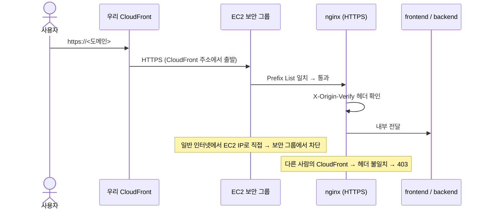

# 03. 네트워크 및 보안 (Network & Security) — v4

> **상태**: `[PROPOSED]` — 아래 nginx 설정·보안 그룹은 **아직 코드(`infra/nginx/nginx.conf`)에 반영되지 않은 설계**예요.
> **원칙**: 최소 권한, 2단계 방어, 비용과 보안의 균형. "완벽 차단"이라는 표현은 쓰지 않아요.

---

## 1. VPC와 서브넷

| 구성 | 값 | 비고 |
|---|---|---|
| VPC | `10.0.0.0/16` | |
| Public Subnet | `10.0.1.0/24` (ap-northeast-2a) | EC2. 인터넷 게이트웨이 연결 |
| Private Subnet A | `10.0.11.0/24` (ap-northeast-2a) | RDS (EC2와 같은 AZ → AZ 간 전송료 없음) |
| Private Subnet C | `10.0.12.0/24` (ap-northeast-2c) | RDS 서브넷 그룹은 AZ 2개가 필요해서 만드는 빈 서브넷 |
| Elastic IP | 1개 | CloudFront 오리진 도메인(`origin.<도메인>`)이 가리킴 |

- **NAT Gateway를 쓰지 않아요**: EC2는 Public Subnet이라 직접 인터넷에 나갈 수 있고, RDS는 인터넷이 필요 없어요.

---

## 2. 보안 그룹

### 2.1 EC2 (`sg-labbridge-ec2`)

| 방향 | 포트 | 출발지/목적지 | 설명 |
|---|---|---|---|
| Inbound | **443만** | CloudFront origin-facing Prefix List (`com.amazonaws.global.cloudfront.origin-facing`) | CloudFront에서 오는 요청만 |
| Inbound | 22 | **열지 않음** | 접속은 SSM Session Manager |
| Outbound | 443 | `0.0.0.0/0` | Discord, Let's Encrypt, SSM, S3, GitHub |
| Outbound | 5432 | `sg-labbridge-rds` | 운영 DB |

> **왜 443 하나만?** Prefix List를 규칙에 쓰면 목록 크기만큼 규칙 칸을 차지해요(문서 기준 55칸 `[UNVERIFIED]`). 보안 그룹 기본 한도가 60칸이라 80번과 443번에 모두 쓰면 110칸으로 넘쳐요. CloudFront가 HTTP 요청을 HTTPS로 바꿔 주므로(Viewer Protocol Policy: Redirect HTTP to HTTPS) 오리진은 443만 있으면 돼요.

### 2.2 RDS (`sg-labbridge-rds`)

| 방향 | 포트 | 출발지 | 설명 |
|---|---|---|---|
| Inbound | 5432 | `sg-labbridge-ec2` | EC2 컨테이너만 접속 |

- RDS는 **퍼블릭 접근 끔**(Publicly accessible = No).

### 2.3 운영 DB 접속 경로 (v4, 강사님 피드백)

비공개 RDS에는 인터넷에서 바로 접속할 수 없으므로, **SSM 포트 포워딩 터널 하나**를 공식 경로로 정해요.

```bash
aws ssm start-session --target <EC2-ID> --document-name AWS-StartPortForwardingSessionToRemoteHost --parameters host="<RDS-주소>",portNumber="5432",localPortNumber="15432"
```

터널을 연 뒤 내 PC의 `localhost:15432`로 접속해요.

| 방법 | 추가 비용 | 판단 |
|---|---|---|
| **SSM 포트 포워딩** | $0 (EC2 대상 세션) | **채택**: 포트 추가 없음, 접속 기록·사람별 권한 |
| RDS 공개 + IP 허용 | IPv4 $3.65 | 비공개 설계가 깨지고 팀원 IP 변경마다 수정 |
| 별도 점프 서버 | $7 이상 | 관리할 서버와 열린 포트 증가 |

- **준비물**: AWS CLI, Session Manager 플러그인, 사람별 IAM 권한(`ssm:StartSession`을 이 EC2와 포트 포워딩 문서로만 제한). 공용 계정은 쓰지 않아요.
- **보안 그룹 변경 없음**: 터널은 EC2를 거치므로 RDS 입장에서는 EC2에서 온 연결이에요.
- **절대 금지**: 터널을 연 상태로 **로컬 backend를 운영 DB에 연결**하는 것. backend는 켜지는 순간 요청 만료·아침 브리핑 작업을 시작하고(`backend/app/main.py`), 봇 토큰이 있으면 실제 회원에게 DM도 나가요.
- 자세한 사용 규칙은 [04](04-database-storage.md) 6절을 봐요.

---

## 3. CloudFront → EC2 오리진 보호 (2단계)



1. **1단계 (보안 그룹)**: CloudFront 주소에서 온 연결만 받아요.
2. **2단계 (nginx 비밀 헤더)**: CloudFront 오리진 설정에 긴 무작위 값을 헤더로 넣고 nginx가 확인해요. 값은 SSM에 보관하고 주기적으로 바꿔요.
3. **오리진 HTTPS (v3 추가)**: v2는 CloudFront→EC2 구간이 HTTP라 비밀 헤더가 평문으로 인터넷을 지나갔어요. ACM 인증서는 EC2에 붙일 수 없으므로, `origin.<도메인>`에 **Let's Encrypt 인증서를 DNS-01 방식(certbot + Route 53)**으로 받아 nginx에 붙여요. 보안 그룹이 CloudFront만 허용해서 HTTP-01 방식은 쓰기 어려워요. CloudFront 오리진 프로토콜은 "HTTPS only"로 설정해요.

### 3.0 CloudFront 경로 나누기 (v4)

| 경로 | 보내는 곳 | 캐시 | 비고 |
|---|---|---|---|
| 기본 (`*`) | S3 프론트 버킷 (OAC로 CloudFront만 읽기) | HTML 짧게, `_next/static/*` 길게 | CloudFront Function으로 주소 연결 |
| `/api/v1/*` | EC2 `origin.<도메인>` (HTTPS only, 비밀 헤더) | 끔, 쿠키·쿼리 전달 | 모든 HTTP 메서드 허용 |

- **S3 버킷은 공개하지 않아요**: 퍼블릭 액세스 차단을 켜고 OAC(Origin Access Control)로 우리 CloudFront만 읽게 해요.
- **CloudFront Function이 필요한 이유**: S3에는 `/workspace/0.html` 같은 빈 화면 파일만 있어요. `/cases`→`/cases.html`, `/workspace/4`→빈 화면 파일로 연결해요. 디스코드·구글 캘린더 알림이 `/workspace/{번호}` 주소를 쓰므로 주소는 바꾸지 않아요. 월 200만 회까지 무료 `[CONFIRMED: Price List]`. 화면 이동에 쓰는 `.txt` 파일 연결까지 시험이 필요해요 `[UNVERIFIED]`.

### 3.1 nginx에 들어가야 할 것 (현재 `infra/nginx/nginx.conf`에는 없음)

```nginx
server {
    listen 443 ssl;
    server_name origin.<도메인>;
    ssl_certificate     /etc/letsencrypt/live/origin.<도메인>/fullchain.pem;
    ssl_certificate_key /etc/letsencrypt/live/origin.<도메인>/privkey.pem;

    # 2단계: CloudFront 비밀 헤더 (값은 배포 때 SSM에서 주입)
    if ($http_x_origin_verify != "${ORIGIN_VERIFY_SECRET}") { return 403; }

    # 실제 사용자 IP 복원 (CloudFront가 붙이는 헤더 기준)
    real_ip_header CloudFront-Viewer-Address;   # 형식·설정은 배포 전 검증 [UNVERIFIED]

    # 로그인·인증번호 요청 제한
    limit_req zone=auth burst=10 nodelay;
}
```

---

## 4. IAM (EC2 인스턴스 역할 `LabBridgeEC2Role`)

| 권한 | 범위 | 용도 |
|---|---|---|
| `AmazonSSMManagedInstanceCore` | 관리형 정책 | Session Manager 접속, 22번 포트 닫기 |
| `ssm:GetParametersByPath`, `kms:Decrypt` | `/labbridge/prod/*` | 배포 때 비밀값 읽기 |
| `s3:PutObject`, `s3:GetObject`, `s3:ListBucket` | `labbridge-backup-apne2/*` | DB 덤프·업로드 파일 백업 |
| `route53:ChangeResourceRecordSets` | 해당 호스팅 영역만 | Let's Encrypt DNS-01 갱신 |
| `AmazonEC2ContainerRegistryReadOnly` | 관리형 정책 (또는 우리 ECR 저장소만) | 배포 때 backend 이미지 받기 (2026-11-13 추가) |
| `CloudWatchAgentServerPolicy` | 관리형 정책 | 메모리·스왑·디스크 지표 보내기 ([10](10-operations-runbook.md) 5.2절) |
| `logs:CreateLogStream`, `logs:PutLogEvents` | `/labbridge/prod/*` 로그 그룹만 | 컨테이너 로그 보내기 ([10](10-operations-runbook.md) 5.3절) |

- **GitHub Actions 배포 역할(OIDC)**: 프론트 버킷 쓰기, `cloudfront:CreateInvalidation`, ECR 이미지 올리기, 그리고 운영 EC2에 `deploy.sh`만 실행하는 SSM 명령 권한만 허용해요. `main` 브랜치·`production` 환경에서만 역할을 받을 수 있어요 ([14](14-ci-cd-pipeline.md) 6절).

- Bedrock 권한은 AI 기능을 켤 때 추가해요 ([06](06-ai-chatbot-infrastructure.md)).
- **영구 Access Key를 서버나 GitHub에 두지 않아요.** GitHub Actions에서 AWS가 필요하면 OIDC 역할을 써요.

---

## 5. 비밀값 관리

- 저장: **SSM Parameter Store Standard, SecureString** (`/labbridge/prod/JWT_SECRET` 등). 비용 $0 `[UNVERIFIED: Standard 티어 무료]`. Secrets Manager는 개당 월 $0.40 `[CONFIRMED: Price List 2026-09]`라 쓰지 않아요.
- 배포: 배포 스크립트가 SSM에서 읽어 EC2의 `.env.production`(`chmod 600`)을 만들어요.
- **compose 파일에 기본값 금지**: 지금 `docker-compose.prod.yml`에는 `POSTGRES_PASSWORD: admin123`, `JWT_SECRET: ${JWT_SECRET:-labbridge-production-jwt-secret-key-32chars}`가 있어요. 운영에서 환경변수를 빠뜨리면 **Git에 공개된 키로 로그인 토큰을 위조**할 수 있어요. `${JWT_SECRET:?JWT_SECRET 필요}`처럼 값이 없으면 실행이 실패하게 바꿔야 해요 (배포 전 차단 항목).
- 필요한 운영 비밀값 목록은 [05](05-discord-integration.md) 4절과 [04](04-database-storage.md) 2절을 함께 봐요.

---

## 6. 애플리케이션 보안

1. **같은 도메인 사용**: S3 화면과 EC2 API가 CloudFront 한 도메인 뒤에 있어(`https://<도메인>` 과 `/api/v1`) CORS는 그 도메인 하나만 허용해요.
2. **쿠키**: `backend/app/routers/auth.py`는 HTTPS 리디렉트 주소이면 `Secure=True`, `SameSite=None`으로 설정해요 `[CONFIRMED]`. 같은 도메인 배포에서는 `Lax`로도 충분하므로, 전환 후 `Lax`로 바꿀지 검토해요 `[PROPOSED]`.
3. **요청 제한**: 로그인·디스코드 콜백·인증번호 발송에 nginx `limit_req` 적용.
4. **관리자 화면**: `/admin/*`는 앱 권한 검사에 더해, 필요하면 CloudFront 단에서 추가 제한을 검토해요.
