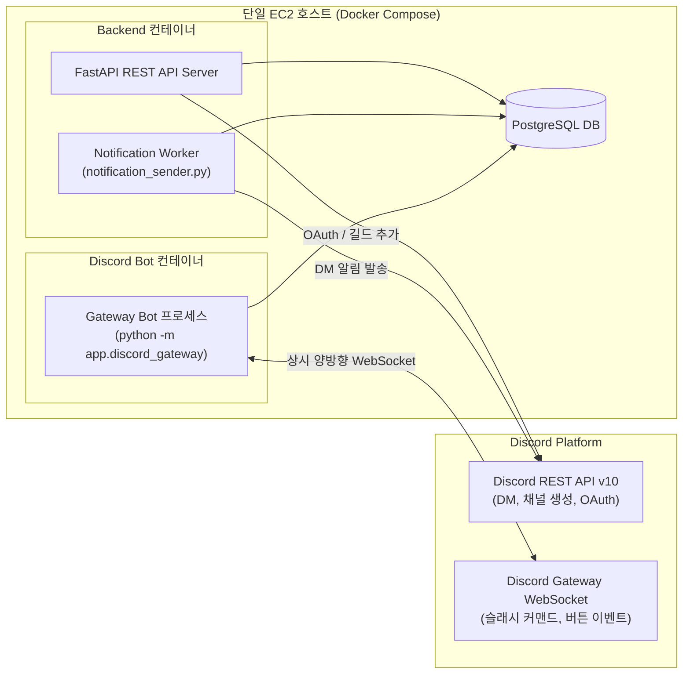

# 05. Discord 연동 아키텍처 (Discord Integration) — 개정판

> **상태**: `[CONFIRMED]` (기존 코드 [`backend/app/discord_bot.py`](file:///backend/app/discord_bot.py), [`backend/app/discord_gateway.py`](file:///backend/app/discord_gateway.py), [`backend/app/collab_channel.py`](file:///backend/app/collab_channel.py) 기반)  
> **핵심 설계**: 1) REST API 기반 기능과 WebSocket Gateway 기능의 명확한 분리, 2) 이메일 자동 병합 금지, 3) Discord Gateway 봇의 독립 컨테이너 격리 운영.

---

## 1. 기존 Discord 구현 현황 상세 분석

| 기능 도메인 | 구현 상태 | 프로토콜 | 동작 원리 및 코드 근거 | AWS 배포 시 요구사항 |
|---|---|---|---|---|
| **Discord OAuth2 로그인** | `CONFIRMED (완료)` | HTTPS REST | Discord 권한 승인 후 `auth/discord/callback`에서 토큰 교환 및 프로필 조회 (`[backend/app/routers/auth.py]`) | Gateway 불필요. `DISCORD_REDIRECT_URI`를 프로덕션 도메인으로 설정 |
| **길드 자동 참여 (`guilds.join`)** | `CONFIRMED (완료)` | HTTPS REST | 로그인 시 획득한 user access_token을 활용해 LabBridge 서버로 회원 자동 초대 (`[backend/app/discord_bot.py]`) | Gateway 불필요. 봇의 `Create Instant Invite` / 멤버 추가 권한 필요 |
| **협업 비공개 채널 생성** | `CONFIRMED (완료)` | HTTPS REST | 협업 확정 시 연구자+전문가+봇만 접근 가능한 `협업-XXXX` 텍스트 채널 자동 생성 (`[backend/app/collab_channel.py]`) | Gateway 불필요. `DISCORD_COLLAB_CATEGORY_ID` 환경변수 설정 |
| **Discord 1:1 DM 알림** | `CONFIRMED (완료)` | HTTPS REST v10 | 협업 요청/수락 시 DM 전송. 지수 백오프 재시도 및 `DmBlocked` 예외 처리 완비 (`[backend/app/notification_sender.py]`) | Gateway 불필요. 백엔드 `notification_sender` 워커에서 처리 |
| **협업 채널 슬래시 커맨드** | `CONFIRMED (완료)` | **WebSocket Gateway** | 채널 내 `/요청`, `/일정`, `/일정목록` 슬래시 커맨드 수신 및 대화형 모달 창 응답 (`[backend/app/discord_gateway.py]`) | **상시 웹소켓 연결 필수**. 독립 컨테이너 운영 권장 |
| **메시지 버튼 인터랙션** | `CONFIRMED (완료)` | **WebSocket Gateway** | 메시지 하단 `[요청 관리]`, `[완료]`, `[기한 변경]` 버튼 클릭 이벤트 수신 및 처리 (`[backend/app/discord_gateway.py]`) | **상시 웹소켓 연결 필수** |

---

## 2. Discord 컴포넌트 컨테이너 배포 구조

FastAPI Web API와 Discord Gateway 상시 봇을 동일 호스트 내에서 독립된 2개 컨테이너로 분리합니다.

- **분리 운영의 핵심 이점**:
  1. **무중단 봇 세션**: 백엔드 REST API 코드 수정이나 재배포 중에도 Discord WebSocket 연결이 끊기지 않아 협업 채널의 사용자 명령어가 유실되지 않습니다.
  2. **장애 격리**: Discord API의 일시적 장애나 봇 메모리 누수가 발생하더라도 Web API 서버(`backend`)는 100% 정상 가동됩니다.

---

## 3. 계정 보안 원칙: 이메일 자동 병합 절대 금지

- **위험 시나리오**: 공격자가 타인의 이메일로 가짜 Discord 계정을 생성한 후, 해당 이메일이 일치한다는 이유로 기존 회원 계정으로 자동 로그인되는 계정 탈취(Account Takeover) 공격.
- **방어 설계 (`[CONFIRMED]`)**:
  - Discord 로그인 시 `users.discord_id`가 일치하는 회원이 없으면, 기존 계정으로 자동 로그인시키지 않고 **신규 회원가입 절차**로 분기하거나,
  - 기존 회원은 로그인된 상태에서 마이페이지(`/settings`)의 'Discord 계정 연결' 메뉴를 통해 본인 인증 후 명시적으로 연동하도록 강제합니다.

---

## 4. AWS 프로덕션 환경 필수 설정값 (환경변수)

| 환경변수 키 | 설명 | 보관 위치 |
|---|---|---|
| `DISCORD_CLIENT_ID` | Discord Application Client ID | SSM Parameter Store |
| `DISCORD_CLIENT_SECRET` | Discord OAuth2 Client Secret | SSM Parameter Store (SecureString) |
| `DISCORD_REDIRECT_URI` | `https://labbridge.kr/api/v1/auth/discord/callback` | SSM Parameter Store |
| `DISCORD_BOT_TOKEN` | Discord Bot Token (Gateway 및 REST 공용) | SSM Parameter Store (SecureString) |
| `DISCORD_GUILD_ID` | LabBridge 공식 디스코드 서버 ID | SSM Parameter Store |
| `DISCORD_COLLAB_CATEGORY_ID` | 협업 비공개 채널이 생성될 카테고리 ID | SSM Parameter Store |
