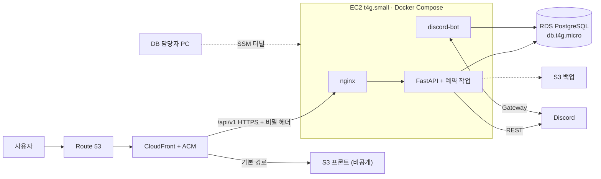

# 13. 강사님 발표 브리프 (Instructor Presentation Brief) — v4

> **프로젝트**: WHAT THE LAB (LabBridge) — 연구자와 AI 전문가 연결 플랫폼
> **목적**: 강사님이 권장하신 **AWS 통합 배포**의 구체 구성·비용·배포 절차와 **피드백 반영 결과**를 보고하기
> **목표 예산**: 월 $50 내외 → **AWS $43.90 + 도메인·부가세 포함 약 $49.5** (EC2 축소 시 AWS $36.31) (부가세·도메인 `[UNVERIFIED]`)
> **상태**: 설계 확정 전 확인 단계. AWS 리소스는 아직 만들지 않음
> **PDF 버전**: `LabBridge_AWS_강사님_발표자료_v4.pdf`

---

## 1. 한 문장 요약
> **화면은 S3 + CloudFront로, API·디스코드 봇은 EC2 한 대로, 운영 DB는 비공개 RDS로 나누고, 배포는 항상 "DB 마이그레이션 먼저" 순서로 합니다.**

### 강사님 피드백 반영
| 피드백 | 반영 |
|---|---|
| 프론트는 CloudFront + S3 | 정적 빌드로 전환. 임시 빌드 성공(10곳 수정 전제) |
| RDS private + 접근 경로 | SSM 포트 포워딩 터널, 포트 추가 없음·$0 |

## 2. 왜 AWS로 통합하나요?
| 지금 (Vercel + Render + Supabase) | 통합 후 (AWS) |
|---|---|
| 디스코드 봇(상시 연결)과 알림 작업을 돌릴 곳이 나뉘어 관리가 어려움 | EC2 한 대에서 backend·봇이 같은 이미지·같은 설정으로 실행 |
| 화면·API 주소가 달라 쿠키를 `SameSite=None`으로 둬야 함 | 같은 도메인 → 쿠키·CORS 단순 |
| 개발 DB(공용 Supabase)를 운영에도 쓰게 될 위험 | 운영 DB(RDS)와 개발 DB 분리 |
| 코드·DB 버전이 따로 움직여 503 사고 경험 | 배포 스크립트 한 개로 "마이그레이션 → 확인 → 재시작" |

## 3. 구성도

## 4. 월 비용 (서울, 공식 단가 2026-11 확인)
| 항목 | 월 |
|---|---|
| EC2 t4g.small | $15.18 |
| 퍼블릭 IPv4 | $3.65 |
| EBS gp3 30GB | $2.74 |
| RDS db.t4g.micro + gp3 20GB | $20.87 |
| S3(백업·프론트)·Route 53·CloudWatch·이미지 저장 | $1.46 |
| CloudFront·ACM | $0.00 |
| **합계** | **$43.90** |
| 도메인·부가세 포함 예상 | 약 $49.5 `[UNVERIFIED]` |

- AI 챗봇은 MVP+라 첫 배포에서 제외($0).
- 프론트를 S3로 옮겨도 EC2가 그대로면 비용은 거의 같아요. 부하 테스트 후 t4g.micro로 낮추면 **$36.31** (월 $7.59 절약).

## 5. 안전장치 4가지
1. **마이그레이션 먼저**: `alembic upgrade head` → `alembic current` = `heads` 확인 → 컨테이너 교체
2. **봇·백엔드는 1개만**: 중복 DM·중복 아침 브리핑 방지, 개발용 디스코드 앱 분리
3. **오리진 보호**: 보안 그룹 443(CloudFront 목록만) + nginx 비밀 헤더 + CloudFront→EC2 HTTPS
4. **백업은 복원까지**: RDS 자동 백업 7일 + 주 1회 S3 덤프 + 월 1회 복원 테스트

## 6. 지금까지 확인한 것 / 아직 못 한 것
| 확인함 | 아직 |
|---|---|
| 로컬 5개 컨테이너 기동, 유휴 메모리 324MiB `[LOCAL_VERIFIED]` | 동시 접속 부하, ARM64 빌드 |
| 알림·구글 동기화 중복 방지(`SKIP LOCKED`) 구현 `[CONFIRMED]` | 실제 디스코드 서버 E2E |
| 서울 단가 (EC2·RDS·EBS·S3·IPv4·CloudFront) `[CONFIRMED]` | 부가세, 도메인 가격 |
| 마이그레이션 코드가 Supabase 전용 역할을 `IF EXISTS`로 처리 | 빈 RDS에 `alembic upgrade head` 리허설 |

## 7. 강사님께 확인받고 싶은 점
1. ~~"로컬 테스트"의 범위~~ → **답변 받음 (2026-11-10)**: 개발은 공용 Supabase 하나를 모두 같이 쓰고 데이터를 최신으로 유지 ([15](15-instructor-feedback-20261110.md)).
2. ~~t4g.small → micro 순서~~ → **답변 받음**: micro로 테스트해 보라. ALB는 "있으면 좋으니 금액을 확인해 보라"는 취지 → 월 약 $25.2 (08번 2.1절 비교표).

> **팀 결정 (2026-11-10)**: ALB는 나중으로 미뤄요. 당분간 자체 테스트 + 일부 사용자 베타 운영이에요.
>
> **2026-11-10 기준 강사님께 더 확인할 것은 없어요.** 남은 것은 팀 결정(RDS 유지 여부)과 우리가 측정할 것(micro 부하)이에요 ([15](15-instructor-feedback-20261110.md) 2-1절).
3. 초기에 **EC2 1대(단일 장애점)**를 감수하고, 장애 시 45분 안 재구축 목표로 운영해도 되는지?
4. **CI/CD**: PR마다 CI, 통과해야 머지(브랜치 보호), `main` 머지 후 승인 → SSM Run Command로 "마이그레이션 → 확인 → 교체"를 실행하는 구성이 적절한지? ([14](14-ci-cd-pipeline.md))

## 8. 다음 단계
배포 전 차단 항목 B1~B12 수정 → 로컬 리허설 → 팀 승인 → AWS 리소스 생성 → 전환(Render 정지 후 EC2 봇 시작) ([09](09-deployment-roadmap.md)).
