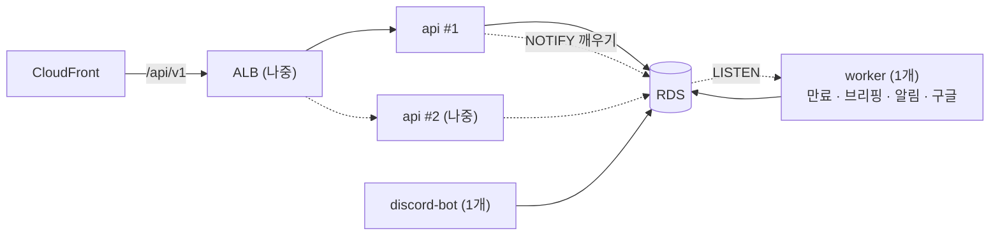

# 16. API 서버와 예약 작업·봇 분리 계획 (API / Worker Split)

> **상태**: `[PROPOSED]` — 코드는 아직 바꾸지 않았어요.
> **작성일**: 2026-11-11
> **왜 필요한가**: ALB를 붙여 서버를 여러 대로 늘리려면, "여러 대여도 되는 부분(API)"과 "반드시 1개여야 하는 부분(예약 작업·디스코드 봇)"을 먼저 나눠야 해요 ([15](15-instructor-feedback-20261110.md) 2-2절).
> **언제**: 1~6단계는 **베타 기간**에 EC2 1대 안에서 진행해요(추가 비용 $0). 7~9단계는 정식 공개 무렵 ALB를 붙이기 전에 해요.

---

## 1. 지금 구조와 목표 구조

| 프로세스 | 지금 | 목표 | 동시에 몇 개? |
|---|---|---|---|
| **api** | FastAPI + 예약 작업 4개 (`backend/app/main.py`의 `lifespan`) | FastAPI만 | 여러 개 가능 (ALB 뒤) |
| **worker** | 없음 | 예약 작업 4개 전담: 요청 만료, 아침 브리핑, 디스코드 알림, 구글 동기화 | **항상 1개** |
| **discord-bot** | 이미 분리됨 (`python -m app.discord_gateway`) | 그대로 | **항상 1개** |

---

## 2. 지금 코드에서 분리를 막는 것 (2026-11-11 확인)

| # | 막는 것 | 위치 | 문제 | 해결 단계 |
|---|---|---|---|---|
| 1 | 알림 **즉시 깨우기** | `main.py` `send_notifications_soon` → `notification_sender.wake_up()`, `google_sync.wake_up()` | 같은 프로세스 안의 `asyncio.Event`라서 worker가 떨어지면 API가 깨울 수 없어요. 그러면 15초 주기로만 처리돼요 | 5 |
| 2 | 아침 브리핑 **하루 1회 판단** | `task_daily.py` `LAST_RUN` (메모리) | 프로세스가 둘이거나 배포 중 겹치면 각자 "오늘 아직"이라고 판단해요 | 3 |
| 3 | 업로드 파일이 **서버 디스크**에 | `upload_store.py` → `UPLOAD_DIR` | api가 2대면 다른 서버에 올린 파일을 못 찾아요 | 7 |
| 4 | 조회수 등의 **요청 제한이 메모리**에 | `routers/analytics.py`, `routers/insight_views.py`의 `_HITS` | 서버마다 따로 세서 제한이 약해져요 | 8 |

이미 괜찮은 부분:
- DM 알림·구글 동기화·채널 생성은 `FOR UPDATE SKIP LOCKED`로 같은 행을 두 번 처리하지 않아요.
- `lru_cache`는 설정·연결 객체 캐시라 서버마다 따로 있어도 괜찮아요 `[CONFIRMED: 코드 확인]`.
- 로그인(JWT 쿠키)은 서버에 상태를 저장하지 않아요.

---

## 3. 단계별 계획

### 베타 기간 (EC2 1대 안에서, 추가 비용 $0)

| 단계 | 할 일 | 바꾸는 곳 | 먼저 쓸 테스트 (AGENTS.md: 실패하는 테스트 먼저) |
|---|---|---|---|
| **1** | 예약 작업 켜기·끄기 설정 `RUN_BACKGROUND_JOBS` (기본값 `true`, 지금 동작 유지) | `config.py`, `main.py` `lifespan` | `false`이면 `lifespan`이 작업을 하나도 만들지 않는지 |
| **2** | worker 입구 `app/worker.py`: 기존 `expire_forever`, `daily_forever`, `run_forever`, `google_sync.run_forever`를 그대로 실행 | 새 파일 | 봇·구글 설정이 없을 때 해당 작업을 건너뛰는지 (지금 `lifespan`과 같은 조건) |
| **3** | 아침 브리핑 하루 1회를 **DB로 판단**: `job_run(job_name, run_date)` 표에 넣고, 이미 있으면 건너뛰기 | 마이그레이션 1개, `task_daily.py` | 같은 날 두 번 호출하면 두 번째는 실행하지 않는지 |
| **4** | worker·봇 **중복 실행 막기**: 시작할 때 `pg_try_advisory_lock`을 잡고, 못 잡으면 기다리기 | `worker.py`, `discord_gateway.py` | 잠금을 이미 누가 잡았으면 일을 시작하지 않는지 |
| **5** | 즉시 깨우기: 처음엔 **최대 15초 지연을 허용**. 필요하면 PostgreSQL `LISTEN/NOTIFY`로 바꾸기 | `main.py` 미들웨어, `notification_sender.py`, `google_sync.py` | NOTIFY를 받으면 15초를 기다리지 않고 처리하는지 |
| **6** | compose 분리: `api`(작업 끔) / `worker`(1개) / `discord-bot`(1개) | `docker-compose.prod.yml`, `deploy.sh` | 로컬에서 세 컨테이너가 같이 뜨고, 협업 요청 후 DM이 가는지 |

- **1~4단계만 해도 효과가 있어요**: ALB가 없어도 "배포 중 아침 브리핑 두 번 발송" 같은 지금의 위험이 줄어요.
- **5단계 판단**: 지금 사용자에게 보이는 차이는 "협업 요청 후 DM이 바로 오느냐, 최대 15초 뒤에 오느냐"예요. 베타 기간에는 15초를 받아들이고, 불편하다는 의견이 나오면 NOTIFY로 바꿔요.
- **배포 순서 (6단계 후)**: 마이그레이션 → api → worker → discord-bot → nginx → 프론트 ([10](10-operations-runbook.md), [14](14-ci-cd-pipeline.md)). 4단계의 잠금 덕분에 새 worker는 옛 worker가 끝날 때까지 기다려요.
- **worker 상태 확인**: worker는 HTTP 포트가 없어요. 마지막 실행 시각을 DB(`job_run`)나 파일에 남기고, 헬스체크가 그 시각이 너무 오래됐는지 봐요 `[PROPOSED]`.

### 정식 공개 무렵 (ALB를 붙이기 전)

| 단계 | 할 일 | 비고 |
|---|---|---|
| **7** | 업로드를 **S3 Presigned 방식**으로 전환 | [04](04-database-storage.md) 5절의 "다음 단계". 앱 코드 변경 |
| **8** | 메모리 요청 제한을 nginx 또는 DB 기반으로 옮기기 | 조회수 중복 방지 정확도 유지 |
| **9** | ALB + api 2대. worker·discord-bot은 1대에 고정 | 비용은 [08](08-cost-estimate.md) 2.1절 (ALB 월 약 $25.2 + 서버 1대 추가) |

---

## 4. 메모리와 비용

| 구성 | 메모리 한도 합계 (추정) | 맞는 서버 |
|---|---|---|
| 지금 (nginx 64 + backend 512 + bot 256) | 832MB | micro(1GiB) 후보, small 여유 |
| 분리 후 (nginx 64 + api 512 + worker 약 192 + bot 256) | 약 1,024MB | **small 권장**, micro는 빠듯 |

- worker는 API 요청을 받지 않아 api보다 작게 잡았어요. 실제 사용량은 측정이 필요해요 `[UNVERIFIED]`.
- 그래서 micro 부하 테스트(B8)는 **분리 전과 후 모두** 재요.
- **micro로 시작했으니 (2026-11-13 결정)**: 6단계(compose 분리)는 2주 테스트 기간이 끝나고 메모리 기록을 본 뒤에 해요. micro라면 한도를 nginx 48 + api 384 + worker 약 160 + bot 192 = 약 784MB로 잡고 스왑 1GB와 함께 시험해요 `[PROPOSED]`. 버티지 못하면 small로 올린 뒤 분리해요. 1~4단계는 메모리가 거의 늘지 않아서 micro에서도 바로 할 수 있어요.
- 베타 기간에는 같은 EC2 안에서 컨테이너만 나누니 **AWS 비용은 그대로**예요.

---

## 5. 하지 않기로 한 것
- **Celery·Redis 같은 작업 큐 도입**: 작업이 4개뿐이고 이미 DB 잠금으로 중복을 막고 있어요. 서버와 비용만 늘어나요.
- **EventBridge·Lambda로 예약 작업 이전**: 디스코드·구글 연동 코드를 많이 바꿔야 해요. 지금 함수를 그대로 쓰는 worker가 더 단순해요.

---

## 6. 아직 확인하지 못한 것
- `expire_now`를 두 프로세스가 동시에 실행했을 때 알림이 중복되는지 (4단계 잠금으로 막을 예정이지만 코드 검토 필요)
- PostgreSQL `LISTEN/NOTIFY`가 RDS에서 연결 끊김 뒤에도 안정적으로 다시 붙는지
- worker 실제 메모리 사용량
