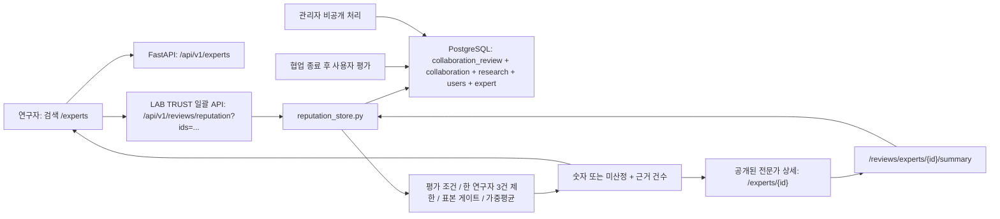

# WHAT THE LAB | LAB TRUST: 플라스크 협업 신뢰 지수
**제품 전략·계량 설계·서비스 청사진·실행 로드맵 — v1.0 / 2026-10-31**

> **기준 저장소**: `feature/expert-search-dark-profile-first-20261031` → Draft PR #72.  
> **본 문서의 구분**: (1) **이번 브랜치에 실제 구현한 내용**, (2) **팀 승인·실사용 검증 필요**, (3) **향후 단계 가설**. 서로 섞어 '완료'로 보고하지 않는다.

## 0. 경영진 의사결정 요약

**의사결정: 원안대로 당근의 매너온도를 복제하지 않는다.** 서비스 이름을 온도에서 연구실 기구인 **LAB TRUST(랩 트러스트)**로 바꾸고, 액체가 차오르는 플라스크를 핵심 모티브로 채택한다. 숫자는 **가입/체류시간/자기소개를 보상하는 인기도**가 아니라 **플랫폼상 정상 종료된 연구 협업에서 실제 참여 연구회원이 남긴 피드백**을 근거로 계산한다.

**인과 가설**: 연구자는 전문분야가 맞는 AI 인재들 중에서 '함께 일해도 되는가?'를 판단하기 어렵다. 신뢰의 **근거·표본 수·불확실성**을 제시하면 전문성 비교 단계에서 불필요한 고민을 줄이고, 양질의 직접 협업 요청을 늘릴 수 있다. 반대로 소수 평가·가짜 거래를 숫자로 포장하면 플랫폼의 신뢰와 매칭 품질을 저하시킬 수 있다.

### 최종 우선순위

| 우선순위 | 선택 | 판단 |
|---|---|---|
| P0 · 이번 구현 | 완료 협업 리뷰 기반 LAB TRUST 0~100 + 플라스크 UI | 기존 `collaboration_review` 데이터·권한 시스템 재활용. 신규 DB 스키마 불필요 |
| P0 · 이번 구현 | 신규 전문가의 **미산정/평가 축적 중** | 기본 36.5점/50점을 신뢰처럼 꾸미지 않음 |
| P0 · 이번 구현 | 3건+서로 다른 연구자 2명, 한 연구자 최대 3건 기여 | 소수 표본과 동일인 반복 협업의 과도한 영향 억제 |
| P0 · 이번 구현 | 검색 목록·전문가 상세에서 동일한 API 기반 지수 | 한 명의 평점이 화면마다 달라 보이는 일 방지 |
| P0 · 이번 구현 | 평가 처리 후 즉시 재산정·운영 비공개 시 반영 제외 | 별도 캐시/수동 점수 조정 없이 항상 DB의 허용된 데이터만 읽음 |
| P1 · 반드시 검증 | 연구 완료 **양측 확인·이의신청·계정 연관성 감지** | 현재 종료 상태는 일정 기준 자동 완료될 수 있어 연구 성과를 독립 검증하지 못함 |
| P2 · 실험 후 판단 | 신뢰 지수로 검색 순위 가중 | 신규 인재의 콜드스타트·편향 위험이 커서 지금은 사용하지 않음 |
| 보류 | 가입점수, 로그인 보너스, 댓글/게시판 활동 점수, 단순 응답속도 경쟁, 유료 점수 상승 | 기술 실력과 무관한 행동을 보상하고 조작을 유도함 |

## 1. 외부 벤치마킹에서 가져온 것과 가져오지 않은 것

| 사례 | 공식/학술 근거 | 취하는 원칙 | 그대로 쓰지 않는 이유 |
|---|---|---|---|
| **당근 매너온도 / Karrot Score** | [당근 공식 보도자료](https://team.daangn.com/company/pr/archive/%EB%8B%B9%EA%B7%BC%EB%A7%88%EC%BC%93-%EB%A7%A4%EB%84%88%EC%98%A8%EB%8F%84-99%EB%8F%84-%EA%B0%80%EC%9E%A5-%EB%A7%8E%EC%9D%80-%EB%8F%99%EB%84%A4%EB%8A%94-%EC%96%B4%EB%94%94/), [글로벌 디자인 변경 사례](https://careers.daangn.com/blog/post/%EB%8B%B9%EA%B7%BC%EB%A7%88%EC%BC%93-%EB%A7%A4%EB%84%88%EC%98%A8%EB%8F%84-%ED%95%B4%EC%99%B8%EC%8B%9C%EC%9E%A5-%EC%A7%84%EC%B6%9C-1/) | 한눈에 읽는 상태 표시, 가치가 녹아든 그래픽 은유 | 36.5℃는 일반 생활 속 거래에 맞는 온도 비유. 전문 연구 협업에선 성실성과 실력이 별도로 평가돼야 함 |
| **Upwork JSS** | [공식 계산/영향 요인](https://support.upwork.com/hc/en-us/articles/38437458199059-How-is-my-Job-Success-Score-calculated), [점수 발급 조건](https://support.upwork.com/hc/en-us/articles/38437546570643-When-will-I-get-a-JSS) | 실제 계약 종료·후기 근거, 신호가 적을 때 점수 보류, 피드백 관련 설명 제공 | 계약금액·결제·장기 고객 등은 WHAT THE LAB의 현재 중개 범위 밖이며 연구 분야별 편향을 만들 수 있음 |
| **Airbnb 상호 평가** | [공식 평가 작성·공개 기간](https://www.airbnb.com/help/article/995) | 종료 후 평가·열람 공개 기간 관리로 보복 위험 축소 | 연구 협업 기간과 정산 구조가 다르므로 14일을 기계적으로 복사하지 않음 |
| **평판 시스템의 조작 연구** | [Krügel & Paetzel (2024), Games and Economic Behavior](https://www.sciencedirect.com/science/article/pii/S0899825624000149) | 평판 조작이 신뢰도 자체를 훼손하므로 부정 방지·검증 비용을 제품 비용으로 포함 | 자동 ‘안전 인증’의 근거로 오용하지 않음 |
| **베이지안/표본 불확실성** | [Evan Miller, Bayesian star-ranking 설명](https://www.evanmiller.org/ranking-items-with-star-ratings.html) | 작은 표본의 극단적 평균에 제동을 거는 평활화(smoothing) | 아래 3.8·5건은 외부 회사 공식 산식이 아니라 팀의 **초기 가설값**, 실데이터 교정 필요 |

**전략적 차별점**: 당근이 '거래에서 좋은 이웃인가?'를 직관적으로 보여준다면, LAB TRUST는 '**함께 연구해 본 다른 연구자가 남긴, 충분한 수의 협업 경험은 어떠한가?**'를 보여준다. 기술별 비교·프로필의 포트폴리오·일정 협의와 **보완적 역할**이어야 하며, 점수 하나로 채용·연구 결정이 끝난다는 인상을 주지 않는다.

## 2. 서비스 설계: 신뢰와 유용성의 분리

### 사용자 Job-to-be-Done
- **연구회원**: 해당 기술을 잘 알고 소통·일정을 지키며 실제 연구 결과물을 낼 사람을 찾고 싶다. 단, 소수 평가를 맹신하고 싶지 않다.
- **AI 전문가**: 등록만 했다는 이유로 낮은 점수를 받아 기회가 막히고 싶지 않다. 좋은 협업 이력이 생기면 공정하게 인정받고 싶다.
- **운영자**: 팀의 수작업 평점 수정 없이 책임 있는 근거가 남고, 악성 리뷰와 조작 신고를 처리하고 싶다.
- **플랫폼**: 잘 맞는 전문가에 대한 **적합한 요청·수락·협업 종료**를 늘리되, 노출 쏠림·허위 평판·분쟁 비용을 악화시키지 않고 싶다.

### 네 가지를 혼동하지 않는다

| 요소 | 무엇을 말하나? | 데이터 근거 | 무엇을 **의미하지** 않나? |
|---|---|---|---|
| **AI 기술 매칭 적합성** | 연구가 요구하는 수행 기술/연구 분야에 맞는가 | 수행 기술·연구 분류 | 신뢰 지수나 품성 자체 |
| **LAB TRUST** | 종료 협업의 연구회원 피드백이 누적된 패턴 | 공개 가능한 `collaboration_review` | 신원 인증, 학력 인증, AI 자격증 실물 확인, 연구 성과 외부 검증 |
| **5점 평가** | 그동안 제출된 실제 평가의 단순 평균 | 기존 공개 평가 API | 조정된 100점 신뢰 지수와 동일한 수치 |
| **현재 참여 상태** | 지금 진행 중인 협업이 있는가 | `collaboration` | 신규 요청 수락 확약 또는 일정 가능성 |

서비스 전체 UX에서 이를 하나의 배지로 혼합하지 않는다.

## 3. LAB TRUST v1.0 계산 규칙 — 실제 구현

### 3.1 데이터가 인정되는 범위

1. 전문가가 **공개 상태·활성 회원**이어야 한다.
2. 실제 `collaboration`과 `research`에 연결된 평가만 인정한다. 평가 작성자는 해당 연구의 **실제 researcher.user_id**여야 한다.
3. `reviewer_side='researcher'`, `reviewee_id=collaboration.expert_id` 조건을 충족해야 한다.
4. 협업 상태가 **`done`**이어야 한다. `ongoing`, `canceled`, `ended_early`는 계산하지 않는다.
5. 종료 후 **7일이 지났고**, 운영자가 비공개로 변경하지 않은 `visibility='visible'` 평가여야 한다.
6. 같은 연구회원의 평가가 반복될 때는 종료일 기준 **최신 3개만** 집계한다. 평가를 무한정 주고받아 올리는 행위를 제한한다.
7. 위 조건을 통과한 결과가 **평가 3건 이상·서로 다른 연구회원 2명 이상**일 때만 숫자 지수를 표시한다.
8. 평가 데이터가 없거나 제한을 못 넘으면 **미산정(`null`)**이다. **0점이 아니다**.

### 3.2 산식 (제품 정책 가설, 외부 공식값 아님)

평가 `i`의 5점 척도 환산:

```text
Rᵢ = 0.30 × 전문성 + 0.35 × 결과물 품질
   + 0.20 × 소통   + 0.15 × 일정 준수
```

표본 `n`과 평활화가 적용된 평균:

```text
R_adjusted = (Σ Rᵢ + 5 × 3.8) / (n + 5)
LAB TRUST = round_half_up((R_adjusted - 1) × 25)
           [0~100 사이로 제한]
```

- `3.8`은 **잠정 기준값**, `5`는 **수학적 완충에 해당하는 가상의 관측 가중치**다. 실제 가짜 후기나 가짜 협업 5건을 생성하는 것이 아니다.
- **점수 발급 전에는 이 prior도 사용자에게 숫자로 표시하지 않는다**.
- 낮은 표본의 1건 변화가 100점 만점 지수를 과하게 뒤집지 않도록 한 초기 설계다.
- 현행 5점 평점은 기존 방식대로 별도로 표시한다. **5점 평균과 100점 지수는 서로 다르다**.
- 금전·논문 수·로그인 횟수·거절 횟수·활동 시간·사진 등록 여부는 **점수에 포함하지 않는다**.

| 사례 (설명용, 가상 계산) | 5점 평가 근거 | LAB TRUST | 플라스크 표시 |
|---|---|---:|---|
| 신규 전문가 | 평가 0건 | 미산정 | 빈 플라스크 · 평가 축적 중 |
| 평가 1건 | 연구자 1명, 5점 | 미산정 | 빈 플라스크 · 평가 축적 중 |
| 반복 협업만 | 같은 연구자 3건, 전부 5점 | 미산정 | **서로 다른 연구자 2명** 미충족 |
| 기준 충족/좋은 평가 | 3건·2명 이상, 전부 4점 | **72** | 인디고 액체 약 72% |
| 기준 충족/우수 평가 | 3건·2명 이상, 전부 5점 | **81** | 청록 액체 약 81% |
| 지속적으로 우수 | 10건·3명 이상, 전부 5점 | **90** | 액체 약 90% |

*위 숫자는 원리 설명용이다. 사용자 로컬 데모 전문가 4명에게 실제 점수로 부여하지 않는다.*

### 3.3 단계 이름 (현재 UI 구현)

| 지수 상태 | UI 문구 | 주의 |
|---|---|---|
| 표본 미충족 | **평가 축적 중** | 아직 검증할 신호가 없다는 뜻이지 저성과·부적합이 아님 |
| 0~64 | **협업 신뢰 관찰 중** | 낮은 평점의 절대적 실패 판정 아님 |
| 65~79 | **안정적인 협업** | 다른 적합성/포트폴리오와 함께 판단 |
| 80~89 | **높은 협업 신뢰** | 여러 평가의 주관적 만족도 근거 |
| 90~100 | **탁월한 협업 신뢰** | 실증된 성과/신원 인증을 뜻하지 않음 |

**출시 정책 검토 메모**: 단계 이름은 전문가에게 직·간접 경제적 영향을 미칠 수 있다. 실제 사용자 평가 분포를 기반으로 언어·경계값·재심사 절차를 반드시 검증해야 한다. 성과물 검증을 제공하지 않으므로 특정 단계에 '인증 전문가' 문구를 사용하지 않는다.

## 4. 화면별 전체 UI 서비스 청사진

### 4.1 검색 목록 `/experts`

- 추천 카드의 우측 패널에 **플라스크 + 100점 지수 + 단계 이름·표본 수**를 넣는다.
- 3열 일반 카드에는 **작은 플라스크 + 간결한 숫자 또는 '평가 축적 중'**을 넣는다.
- 기존 기술 필터·분야 필터·상태 칩·검색어·목록→상세 복귀는 그대로 유지한다.
- **신뢰 지수로 검색 결과를 정렬하거나 결과를 숨기지 않는다.**
- 목록에는 두꺼운 경고나 애니메이션으로 과도한 시선을 빼앗지 않고, 수치와 표본 상태를 같이 표시한다.

### 4.2 상세 페이지 `/experts/{id}`

- 전문가 기본 정보 바로 아래 **큰 프리미엄 플라스크 카드**로 숫자·라벨·표본 근거를 보여 준다.
- '점수 계산 원칙과 신규 전문가 보호 기준'을 펼쳐 볼 수 있다. 전문가가 계산 방식에 대해 질문해도 같은 설명이 나온다.
- 기존 '이 서비스에서 한 연구·평가', 포트폴리오, 경력·학력·자격증 및 오른쪽 협업 요청 CTA 유지.
- 표본이 없어도 포트폴리오·전문성 정보는 볼 수 있어야 한다. **빈 플라스크로 협업 요청을 막지 않는다.**
- 모바일에서는 콘텐츠 뒤로 밀리거나 협업 CTA를 가리는 레이아웃을 피한다.

### 4.3 협업 종료·평가 `/workspace`, `/workspace/{id}#review`

- 평가는 **프로젝트 종료 후** 연구회원·전문가가 각각 작성한다.
- 기존 **30일 작성/48시간 1회 수정/7일 공개 지연**을 재사용한다.
- 연구회원의 평가만 전문가 공개 지수에 반영된다. 전문가→연구회원 평가는 별도 비공개 피드백.
- 후기 신고·관리자 비공개 처리 직후, 다음 공개 API 조회에서 계산 근거가 달라진다.
- 점수·공개 상태가 변해도 새로운 신뢰 지수 레코드를 저장하지 않아 데이터가 어긋나지 않는다.

### 4.4 디자이너용 시각 명세

| 항목 | 이번 구현 명세 |
|---|---|
| 디자인 어휘 | 유리 플라스크(투명 테두리) + 액체 채움 + 미세 기포 + 수위 곡선 |
| 비율 | 0~100 지수 → 유리 내부 액체 높이 비율(정수 점수 기준) |
| 빈 상태 | 회청색 유리, **액체 없음**, '평가 축적 중' 텍스트 |
| 65~79 | 인디고 계열 액체 |
| 80~100 | 청록 계열 액체 |
| 미산정·오류 | 각기 다른 텍스트. **API 오류를 0점이나 미평가로 오인하지 않음** |
| 로컬 가상 데모 | 전용 보라색·청록 액체와 **LAB TRUST · 가상 미리보기 / LOCAL DEMO** 문구 |
| 반응형 | 작은 카드 43px, 강조 카드 61px, 상세 카드 101px 플라스크 |
| 접근성 | SVG 시각장식은 `aria-hidden`; 점수·상태·근거는 실제 텍스트와 aria 라벨로 전달. 주요 설명은 `details`로 제공 |
| 과도한 게이미피케이션 방지 | 매일 출석 보너스, 랜덤 보상, 화면을 차지하는 게임형 폭죽·성과 강요 없음 |

## 5. 데이터 아키텍처: 추가 DB 테이블 없이 연동



- **DB 소스**: 기존 `public.collaboration_review`, `collaboration`, `research`, `expert`, `users`.
- **스키마**: 신규 생성 없음. **평가 시스템 `20261031_21`이 먼저 적용되어 있어야 한다**.
- **계산 장소**: 백엔드 `app/reputation_store.py`, 프론트는 계산하지 않음.
- **일괄 검색**: 결과 한 페이지당 전문가 6명 및 최대 60명까지 **하나의 묶음 요청**으로 신뢰 데이터를 조회. N+1 호출 방지.
- **상세 프로필**: 기존 5점 평가 요약 API 응답에 같은 `reputation` 자료 추가. 불필요한 새 상세 요청 방지.
- **데이터 무결성**: 공개 전문가 상태 검사, 협업 ID 및 평가자-연구 소유자 대조, 공개 제한, 한 사용자별 윈도 함수 최종 3건.
- **재계산 시점**: API 호출 시 SQL로 재산정. 새 평가, 수정, 7일 경과, 운영 비공개에 대해 **별도 배치·캐시 무효화 없이** 현재 상태를 반영.
- **오류 처리**: 평점 테이블 미준비/네트워크 장애 시 '조회 불가'로 구분, **조작된 가짜 점수 폴백 금지**.
- **로그인 권한**: 공개된 전문가의 신뢰 지수 조회는 비로그인도 가능. 평가 작성/수정/신고/운영은 기존 인증과 서버 권한 사용.

**상세 위치**
- `backend/app/reputation_store.py` — 단일/일괄 계산 + 점수 함수
- `backend/app/routers/reviews.py` — 일괄·단일 공개 조회 API
- `backend/app/review_store.py` — 기존 별점 요약에 신뢰 지수 주입
- `frontend/src/components/lab-trust-indicator.tsx` — 반응형 SVG 플라스크
- `frontend/src/components/expert-search.tsx` — 추천/그리드 카드 연동
- `frontend/src/components/expert-profile-view.tsx` — 상세 페이지 연동
- `frontend/src/lib/expert-local-demo.ts` — 로컬에서만 허용하는 시연용 액체
- `frontend/src/lib/reviews.ts` — `ReputationSnapshot` 계약·일괄 API

## 6. 악용·평판조작·전문가 공정성 정책

| 리스크 | 이번 구현에 포함된 방어 | 한계 및 다음 단계 |
|---|---|---|
| 가입만으로 신뢰 지수 획득 | 0건은 미산정, 본인 소개·로그인·포트폴리오는 점수 제외 | 새 전문가는 검색·요청 가능성을 계속 보장 |
| 동일 연구자의 반복 칭찬 | 한 작성자의 **최근 3건만** 반영 | 여러 가짜 계정의 공모는 현재 식별 불가 |
| 자기평가·무관한 제3자 평가 | 서버의 협업 소유권·역할 검증 및 기존 DB 제약 | Discord 계정 자체가 실제 기관 신원 인증은 아님 |
| 허위 종료 | 종료된 프로젝트 DB 기록이 있어야 평가 가능 | **현행 `done`은 일정 기준 자동 완료 가능**, 실제 결과물 검수 증명이 아님. 양측 종료 확인·이의신청 P1 |
| 보복 평가 | 기존 7일 공개 대기·양방향 평가 결과 분리 | 기간 내 상호 협박·외부 연락은 별도 신고 체계 필요 |
| 비방·비밀정보 공개 | 공개 후기 익명화, 신고/관리자 비공개, 숨김 제외 산식 | 자동 개인정보 탐지·재심·신고 SLA·보존기간 P1 |
| 신규 인재를 영구히 저평가 | 초기 미산정·검색 순위 페널티 없음, 3건+2명 발급 | 최초 협업 확보 기회 자체는 매칭 UX/온보딩으로 확보해야 함 |
| 소수 표본 과대평가 | 수학적 prior(3.8, 5건)로 평활화 | 실제 평가 분포·편향에 따라 파라미터 재조정 |
| 점수 인센티브로 무리한 프로젝트 수락 | 수락률·응답시간·건수 자체를 직접 보상하지 않음 | 정성 면담으로 전문가의 행동 왜곡 평가 |
| 알고리즘 설명 부족 | 공개 프로필에서 산식과 제외 사유 설명 | 운영자용 상세 이의신청·데이터 계보 조회 P1 |

## 7. 전환율·품질의 지표 체계 (실측 전 가설)

### North Star Metric
**Qualified Direct Collaboration Request Rate (QDRR)**  
**정의**: AI 기술·연구 분야 맥락을 보유한 전문가 상세 조회 세션 중, 유효한 등록 연구를 선택해 실제 직접 협업 요청을 보낸 세션의 비율.

> 주의: 단순 클릭률이 아니다. 연구자·전문가 간 기술 적합성과 유효 요청 단위를 별도로 확인해야 한다. 현재 분석 도구가 이 정의 그대로 수집된다고 가정하지 않는다.

| 구분 | KPI / 관찰 방식 | 목적 |
|---|---|---|
| 탐색 | 검색→상세 클릭률, 필터별 상세 진입 | 플라스크가 탐색을 돕는지 |
| 고려 | 상세→실제 요청 전환, 세션 기준 | 선택 불확실성 해소 |
| 매칭 품질 | 수락률, 협업 시작률, 정상 종료율 | 무의미한 요청 증가 방지 |
| 평가 품질 | 완료 건 대비 후기 제출율, 지수 발급률 | 점수 표본 유동성 확인 |
| 건전성 | 후기 신고율·비공개율·처리 지연·다중 계정 의심 비율 | 평판 조작의 비용 |
| 신규 인재 공정성 | 평가 0건/1~2건 전문가의 상세→요청 전환, 상위 노출 점유율 | 신규 전문가 배제 여부 |
| 지표 신뢰 | 별점과 지수 차이에 대한 사용자 이해도·설명 조회 | 수치가 오인되는지 |

**제품 실험 설계 (향후, 아직 실시하지 않음):**
- A: 기존 별점·후기만 / B: 별점·후기 + LAB TRUST 플라스크.
- 연구자 세션을 랜덤 배정하고 공개 전문가 풀·기술 필터 조건은 유지.
- **Primary**: 적합 직접 요청 전환률, **Guardrails**: 스팸 요청·수락률·신규 전문가 노출·신고율.
- 최소 실험 표본·기간·통계 검정/검정력은 실제 트래픽으로 사전 산정. **현재 성과 개선 수치나 유의성을 주장하지 않는다.**
- 자동 순위 반영은 해당 실험과 공정성 감사를 통과한 뒤에만 별도 결정.

## 8. 도입 운영: 단계별 의사결정 게이트

| 단계 | 완료 기준 | 책임 구분 |
|---|---|---|
| **P0 — 현재 브랜치에 코드 반영** | 생산용 계산 SQL, SVG, 목록·상세 API, 순수 함수 테스트, PostgreSQL CI | 개발 담당 |
| **P0 QA** | 전체 CI/TypeScript/build 통과, 로컬 동일 계정·서로 다른 계정·평가 수정·신고 시나리오 확인 | 기능 담당 + 팀 통합 |
| **P1 — 운영 정책 확정** | 3건/2명·3.8/5 파라미터 승인, 등급 표현/정정 정책, 가짜 협업 대응 기준, 개인정보 고지 | PO + 운영 + 개인정보 담당 |
| **P1 — 실사용 안전성** | 연구 종료 양측 확인/분쟁 대응, 악의적 후기 재심, 신원 연관성 분석 방법 및 개인정보 영향평가 | 백엔드 + 운영 |
| **P2 — 제한된 사용자 실험** | 전환률과 부작용 함께 평가, 표본 충분성·공정성 분석 | 제품 분석 담당 |
| **P3 — 고도화 판단** | 데이터 기반 파라미터 재학습, UI 정교화, 필요 시 독립적 모델·정렬 가중 검토 | PO + 전체 팀 |

**출시 전 실패 조건**: 실제 DB가 준비되지 않았는데 지수가 0점으로 노출, 로컬 가상 점수가 실제 평점으로 유출, 제3자가 비공개 전문가의 지수를 조회, 한 계정 반복 거래로 점수가 무한 상승, 평가 변경·관리자 숨김이 반영되지 않음, 정해진 분모 없이 트래픽 지표 개선을 주장함.

## 9. 남은 제한 — 반드시 정직하게 고지

1. **프로젝트 종료 상태는 연구 성과·논문·코드 품질을 플랫폼이 외부 검증한 증거가 아니다.** 본 지수는 '평가자가 그 프로젝트에 참여한 사용자이고, DB상 정상 종료되어 공개 가능한 후기'라는 의미이다.
2. **가짜 다중 Discord 계정/공모를 완전히 막지 못한다.** 최소 평가자 수와 중복 상한은 조작 비용을 늘리는 기초 장치다.
3. 플라스크 점수는 전문가에 대한 **개별 연구 과업 적합성·연구 윤리 준수·자격증 진위 보증**이 아니다.
4. 실서비스 사용자가 평가하도록 현재 팀 공용 DB에 이 브랜치의 새 평가 스키마가 적용돼 있다고 가정하지 않는다. **개인 Docker와 팀 공용 DB는 별개**다.
5. 향후 추천/랭킹 가중·민감정보 자동 필터·유료 프로필 부스팅·본인 확인·분쟁 중재는 **이번 브랜치에서 구현했다고 주장하지 않는다.**
6. UI/계산 도입은 실험 결과가 나오기 전 **효과가 입증된 사업 성과가 아니라 검증 가능한 제품 가설**이다.

## 10. 품질 검증

- **Backend**: `backend/tests/test_reputation_store.py` — 최소 표본, 2명 게이트, 연속 개선, 수치 상한, ID 검증, 공개·숨김 제외·권한 보장.
- **PostgreSQL 17**: `backend/tests/sql/reputation_scoring_seed.sql` + `backend/tests/build_reputation_ci_query.py` — 기존 실물 리뷰 SQL을 일회성 CI DB에서 실행, 동일 연구자 3건 상한과 비공개·중도 종료·7일 미경과 제외 검증.
- **Frontend**: `frontend/tests/lab-trust.test.cjs` — 실제 React SVG 렌더링·빈 상태·조회 장애·가상 시연 라벨·일괄 API.
- **추가 사전 검수**: `docs/qa/lab-trust-100-questions-20261031.md`.
- **실사용 검증**: Discord 실제 로그인·서로 다른 연구자 계정·정상 종료의 자동 상태 변경·평가 공개 대기·후기 신고 처리·1440/768/390px 접근성은 별도 확인해야 한다.

---

**제품 원칙 한 줄:** LAB TRUST의 액체는 '인기'나 '게임 점수'가 아니라 **공개 가능한 연구 협업 경험의 근거가 충분할 때만 나타나는 시각 언어**다. 사용자가 질문하면 데이터 출처, 계산 방식, 빠진 신호, 오류/이의신청 경로를 설명할 수 있어야 한다.
