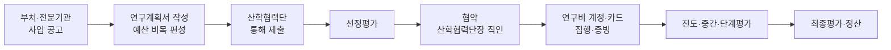

# 연구자 커뮤니티 · AI 개발자 매칭 플랫폼 시장조사

Sep 23, 2026 · @향유랑

## 핵심 요약

핵심 고객은 5,900개 연구소가 아니라 과제를 수주한 이공계 연구실이고, 차별점은 커뮤니티가 아니라 "연구비로 결제 가능한 AI 개발 매칭"이다. 전국 단위 연구자 커뮤니티는 이미 여럿 운영 중이라, "대학·지역 커뮤니티만 있다"는 기획 전제는 수정이 필요하다.

- **프로젝트 주제**: 폐쇄적인 연구자들이 자유롭게 의견을 나누고, AI 기술이 필요한 연구 프로젝트를 부트캠프 수료자·검증된 프리랜서와 연결하는 플랫폼
- **시장**: 대학 연구개발비 8조 8,080억 원(2024), 재원의 74.5%가 중앙정부
- **결제 통로**: 연구비 비목 중 외부 전문기술 활용비(직접비의 40% 범위)로 외부 개발 비용 지급 가능
- **현장의 더 큰 문제**: 연구비 변동성, 학생인건비·생활고, 지도 체계 부족, 연구행정 부담

## 시장 규모

국내 대학 연구는 전임교원 약 7.3만 명, 대학원생 약 36만 명, 연 약 9조 원 규모다. 기본 자료는 한국연구재단 「2025년도 대학연구활동실태조사 분석보고서」(408개 대학, 2024년 실적)다.

| 항목 | 수치 | 기준 |
| --- | --- | --- |
| 대학·대학원 전임교원 | 72,938명 (전문대 포함 84,103명) | 2024 |
| 대학부설연구소 | 5,900개 (2020년 대비 +8.1%) | 2024 |
| 부설연구소 전임연구원 | 5,494명 | 2024 |
| 분야별 최다 연구소 | 공학 1,588개 | 2024 |
| 대학 연구개발비 (실태조사) | 8조 8,080억 원 (전년 대비 -3.1%) | 2024 |
| 대학 연구개발비 (연구개발활동조사) | 11조 538억 원 (전체의 8.4%) | 2024 |
| 대학 소속 연구원 | 120,974명 (전체의 19.7%) | 2024 |
| 대학원생 (석·박사) | 363,330명 | 2026 |
| 학생인건비 지급 인원 | 학사 16,171 / 석사 32,342 / 박사 23,836명 | 2023 상반기 |

분야별 연구개발비는 공학 47.1%, 의약학 21.2%, 자연과학 17.8%로, AI 수요도 이 세 분야에 몰려 있을 가능성이 높다.

**주의: 연구소 수를 그대로 시장으로 잡으면 과대평가다.** 2019년 분석에서 4년제 대학 연구소의 62%가 연구원이 없는 '유령 연구소'로 지적됐다. 인문·사회 연구소 2,282개 중 연구재단 등의 지원을 받는 곳은 226개(약 10%)라는 분석도 있다. 실제 고객 단위는 **과제를 수주한 연구책임자(교수)의 연구실**로 잡는 것이 정확하다.

열린 질문: 국가R&D 비목별 집행 현황에서 "외부 전문기술 활용비" 실집행액을 찾으면 TAM을 더 정확히 추정할 수 있다 (KISTEP 조사·분석 보고서 확인 필요).

## 연구비 재원과 과제 수행 절차

대학 연구비의 74.5%는 중앙정부 돈이라, 국가연구개발혁신법과 연구개발비 사용 기준의 통제를 받는다. 나머지는 민간 15.7%, 교내 5.7%, 지자체 3.4%다.

민간 과제(산업체 위탁·용역)는 연구계약서를 맺고 청구 공문과 세금계산서로 연구비를 청구한다.

### 외부 개발자에게 돈이 가는 통로

| 비목 | 내용 | 플랫폼에 주는 의미 |
| --- | --- | --- |
| 외부 전문기술 활용비 | 기술도입비, 전문가 활용비(자문료 등), 연구개발서비스 활용비. 직접비의 40% 범위 | 핵심 결제 통로 |
| 외주 용역비 (일부 사업) | 핵심 공정·기술 개발을 제외한 일부를 제3자에 위탁 | 주변 개발(데이터 파이프라인, 분석 도구, 시연 웹)이 현실적 첫 수요 |
| 소프트웨어·클라우드 활용비 | SW 구입·임차, 클라우드 이용료 | SaaS형 도구 결제 가능성 |

모든 지출에는 세금계산서, 거래명세서, 계약서 등 증빙이 필요하다.

설계 시사점:

1. 외주 비용은 계획서 단계에서 편성돼야 하므로, 플랫폼은 과제 제안 단계부터 개입해야 한다.
2. 개인 프리랜서보다 사업자 등록된 공급자가 산학협력단 행정에 유리하다. 견적·계약·세금계산서 표준 흐름이 차별점이 된다.
3. 정부 AI바우처는 수요 측이 중소·중견기업, 의료기관, 소상공인이라 대학 연구실은 사각지대다. 기획서에서 "기존 정책이 커버하지 못하는 영역"으로 쓸 수 있다.

## 연구비 신청 조건과 절차

연구비는 개인이 아니라 기관을 통해 받는 구조라, 조건의 핵심은 소속 기관이다. (정부 기초연구사업 2026년 기준, 세부 조건은 사업·연도별 신청요강 확인 필요)

| 조건 | 내용 |
| --- | --- |
| 소속 | 대학 교원(전임·비전임), 국공립·정부출연연구소 연구원. 비전임은 관리기관을 통한 신청 공문 필수 |
| 경력 | 사업별 상이. 예: 한우물파기 박사 취득 후 15년 이내, 신진연구 7년 이내 (출산·육아 휴직 기간 제외) |
| 수행 제한 | 개인 기초연구는 연구책임자로 1인 1과제. 신규 신청도 개인 1개·집단 1개. 국가R&D 전체는 3책 5공 |
| 제재 이력 | 참여제한 제재기간이 접수마감 전날까지 종료돼야 신청 가능 |

신청 절차:

1. **사전 준비**: IRIS 가입, NRI 연구자 전환, KRI 연구업적 등록. 미비 시 접수 불가
2. **공고 확인·계획서 작성**: 연구계획서 + 대표 연구실적
3. **IRIS 제출 + 주관연구기관 승인**: 기한 내 기관 승인까지 끝나야 접수 완료. 마감 5일 전 업로드 권장
4. **선정평가 → 협약 → 연구비 지급**: 2026년부터 간접비 분리지급(직접비만 신청, 간접비는 선정 후 별도 지급)

### 소속이 없는 박사의 경로

| 사업 | 내용 |
| --- | --- |
| 박사후국내연수 (이공) | 대학원 설치 대학·국공립 연구기관에서 1\~3년, 연 6천만 원, 2026년 150개 내외 |
| 학술연구교수 (인문사회) | A유형(5년) 1,882명 내외, B유형(1년, 연 2천만 원) 1,295명 내외 |
| 대학 자체 펠로우십 | 예: 서울대 Frontier Fellowship. 무직도 신청 가능하나 연구원 임용이 전제 |

설계 시사점:

- **자격 기반 공고 추천**: 학위 취득 연도, 소속 형태, 수행 중 과제 수로 신청 가능한 공고를 추천
- **호스트 연구실 매칭**: 박사후연수를 받아줄 연구실과 미취업 박사를 연결하는 연구자-연구자 매칭 사례

## 기존 연구자 커뮤니티와 전제 재검토

전국 단위 연구자 커뮤니티는 이미 여럿 있어서, "전국 연구자를 묶는 커뮤니티" 자체는 차별점이 되기 어렵다.

| 서비스 | 성격 |
| --- | --- |
| [BRIC](https://www.ibric.org/bric/index.do) | 생명과학 연구자 커뮤니티·정보센터. 2016년 회원 약 5만 3천 명 |
| [하이브레인넷](https://www.hibrain.net/index.html) | 교수·연구직 채용정보 중심 |
| 김박사넷 | 대학원·연구실 정보, 대학원생 커뮤니티 |
| KOSEN, 한국과학기술인연합(scieng), CHERIC | 과학기술인 네트워크·분야별 정보센터 |
| 디시 대학원 갤러리, 아카라이브, 전국대학원생노조 | 익명 커뮤니티·권익 단체 |

### 기존 커뮤니티의 한계

각자 한 가지 역할은 잘하지만, **연구를 같이 하게 만드는 기능**이 비어 있다는 것이 공통된 한계다.

| 한계 | 내용 |
| --- | --- |
| 분야·목적이 좁음 | BRIC은 생명과학 중심, 하이브레인넷은 채용정보 중심, KOSEN·CHERIC은 분야별 정보센터. 분야를 넘나드는 교류가 어려움 |
| 익명 커뮤니티의 신뢰·법적 리스크 | 김박사넷은 교수 평가를 두고 손해배상 소송을 겪었고, 대법원 최종 승소 후에도 해당 교수의 이름·사진을 지우고 한 줄 평을 차단함. 이용자 사이에서도 학부생 평가 비중이 높고 초기 악평이 회복되지 않는다는 불만이 있음 |
| 정보 소비에서 끝남 | 읽고, 불평하고, 채용공고를 보는 곳. 공동연구자 찾기, 외부 전문가 계약, 과제 공동 기획 같은 협업 흐름이 없음 (분석, 인터뷰 확인 필요) |
| 교수와 학생의 분리 | 김박사넷·디시 갤러리는 학생 공간이고 교수는 평가 대상으로만 등장. 예산을 쥐고 있는 사람과 실무자가 한 공간에 없어 외부 매칭 같은 의사결정이 일어날 수 없음 |

설계 시사점:

- **평가 기능은 거래에 묶기**: 연구실 평가는 법적 분쟁 위험이 커서 초기에는 넣지 않는다. 대신 완료된 협업 프로젝트에 대한 양방향 후기만 허용한다.
- **역할별 가입**: 교수(의사결정자)와 학생(실무자)이 각자 다른 역할로 들어오게 설계해야 협업 성사가 가능하다.

제안: 순서를 뒤집는다. **연구비로 결제 가능한 AI 개발 매칭을 핵심 가치로 먼저 세우고**, 커뮤니티는 그 거래를 둘러싼 정보 공유(과제 제안서 팁, 외주 후기, 연구행정 Q&A)로 붙인다. 이렇게 하면 기존 서비스와 겹치지 않는다.

## 링크드인과의 차별점

"프로필 + 인맥 + 기회 연결"이라는 뼈대는 링크드인과 비슷하다. 차이는 링크드인이 **사람(커리어) 중심**이고, 이 플랫폼은 **과제(연구 프로젝트) 중심**이라는 점이다. 링크드인의 단위가 "이 사람이 누구인가"라면, 이 플랫폼의 단위는 "이 과제에 무엇이 필요한가"다.

| 구분 | 링크드인 | 이 플랫폼 |
| --- | --- | --- |
| 연결 이후 | 연결에서 끝. 계약·지급·증빙은 각자 | 연구비 비목에 맞는 견적서·계약서·세금계산서 흐름까지 제공 |
| 시간 축 | 없음 | 과제 공고 → 계획서 → 수행 → 평가 주기에 맞춰 필요한 사람 추천 |
| 공개 범위 | 전부 공개가 목적 | 과제 단위 단계별 권한 (공개 요약 / 상세 계획 / 비밀유지 서약 후 공개) |
| 검증 기준 | 경력, 추천 글 | 논문, 수행 과제, 완료된 협업 이력, 연구 데이터 경험·보안 서약 |
| 익명성 | 실명만 | 거래·협업은 실명, 고민 상담·정보 공유는 익명으로 분리 |

익명 공간에서는 특정인 평가를 제한하는 규칙이 필요하다. 김박사넷은 교수 평가를 두고 소송까지 갔고, 최종 승소 후에도 해당 교수의 한 줄 평을 차단했다.

링크드인에서 가져올 점: 프로필이 곧 이력서가 되는 구조. 협업 프로젝트를 완료할 때마다 개발자 포트폴리오에 자동으로 쌓이면, 부트캠프 수료생은 링크드인에 없는 "연구 프로젝트 경력"을 얻게 돼 참여 동기가 생긴다.

## 커뮤니티보다 큰 현장 문제

현장의 급한 문제는 커뮤니티 부재보다 돈, 지도 체계, 그로 인한 소진이다.

| 문제 | 근거 |
| --- | --- |
| 연구비 변동성 | 2024년 R&D 예산 삭감 때 출연연 설문에서 연구책임자 과반이 연구 진행 곤란·인건비 부족 호소. 2024년 대학 연구개발비 3.1% 감소 |
| 학생인건비·생활고 | 학생 지원이 교수가 수주한 과제에 전적으로 의존. KAIST 대학원생 평균 월급여 158만 원, 56.0%가 생활고 |
| 지도 체계 부족 | 대학원생 증가 속도가 교원보다 빠름. 응답자 33.2%가 충분한 지도를 못 받음 |
| 권력 구조와 폐쇄성 | 지도교수가 학점·인건비·졸업·추천서를 좌우하는 도제식 구조 |
| 연구행정 부담 | 지출마다 증빙·보고 절차 |
| 신진 연구자 소진 | 단기 계약, 진로 불확실성, 고립감이 정신건강 지표 악화의 요인으로 지목됨 |

폐쇄성은 커뮤니티 부재보다 권력 구조 문제에 가까워서, 의견 공유 기능을 넣는다면 익명성 보장이 설계의 핵심이다.

AI 수요는 검증이 필요한 가설이다. 2023년 연구재단 조사에서 응답 교원 2,822명 중 10.9%만 생성형 AI를 연구에 써 봤다. 지금은 더 높겠지만, "AI 개발 외주" 수요는 직접 확인해야 한다.

## 대학원생 증가 추세와 원인

대학원생은 5년 동안 꾸준히 늘었고 증가 폭이 해마다 커지는 반면, 전임교원은 줄었다. 급격한 단발성 증가가 아니라 2020년 전후 반등, 2024년부터 가속한 2단계 흐름이다.

| 연도 | 대학원 재적생 | 전년 대비 | 전임교원 (고등교육 전체) |
| --- | --- | --- | --- |
| 2021 | 327,415명 | - | 90,464명 |
| 2022 | 333,907명 | +2.0% | 89,257명 |
| 2023 | 336,596명 | +0.8% | - |
| 2024 | 342,325명 | +1.7% | 87,318명 |
| 2025 | 351,774명 | +2.8% | 86,701명 |
| 2026 | 363,330명 | +3.3% | - |

대학원생은 대학원대학·부설대학원 포함, 전임교원은 전문대 포함 고등교육 전체 기준이다(시장 규모 표의 4년제 전임교원 72,938명과 기준이 다름). 전임교원 1명당 대학원생은 2021년 약 3.6명에서 2025년 약 4.1명으로 늘었다. 같은 기간 비전임교원은 계속 증가했다.

### 증가 원인

- **국가 R&D 확대와 지원사업**: 이공계 대학원생은 2021년 87,642명에서 2025년 101,293명으로 연평균 3.7% 증가(STEPI). R&D 연구비 확대와 대학원생 지원사업 신설·확대가 주요인
- **취업난**: 비이공계 취업률이 낮아 이공계 대학원 수요가 몰림
- **외국인 유학생**: 대학원 재적생 중 외국인은 2008년 12,388명(4.1%)에서 2023년 48,153명(14.3%)으로 약 4배. 학령인구 감소 속에서 대학이 충원을 위해 유학생을 확대. 다만 언어능력 기준 충족자는 절반 미만

### 전환점

1. **2020년 전후 반등**: 이공계 석사과정생은 2015∼2020년 연평균 1.3% 감소 후 2021∼2025년 4.9% 증가로 반등. 대학원 재학생 충원율은 2019년 93.6%가 바닥, 2021년 97.7%
2. **2024년부터 가속**: 유학생 급증과 겹침. 전체 유학생 2022년 166,892명 → 2025년 253,434명. BK21 외국인 대학원생 지원(2024년 3,740명) 등 유치 정책 확대. 2024년 R&D 예산 삭감에도 증가 폭이 커진 것은 유학생 유입이 상쇄한 것으로 추정(국내·외국인 분리 수치로 확인 필요)
3. **향후 감소 전망**: 이공계 석사는 2027년, 박사는 2030년 이후 감소로 전환해 2050년 현재의 약 60% 수준(STEPI)

설계 시사점:

- **지도 공백**: 교수 1인당 학생이 늘어 동료·선배 연구자 간 정보 공유 수요가 구조적으로 커짐
- **외국인 대학원생 틈새**: 7명 중 1명꼴이며 언어 장벽으로 기존 한국어 커뮤니티에서 소외된 집단
- **장기 리스크**: 2027년 이후 감소가 예상되므로, 대학원생 수보다 과제·연구비 흐름에 묶인 매칭 모델이 안정적

## 미취업 석·박사 현황

신규 박사 3명 중 1명이 무직이며, 이 집단은 플랫폼의 공급자로 잘 맞는다.

| 지표 | 수치 |
| --- | --- |
| 2025년 신규 박사 응답자 | 10,498명 |
| 취업·취업 확정 | 66.7% |
| 무직 (미취업 27.7% + 비경제활동 5.6%) | 33.3% (연 약 3,500명), 2014년 조사 이래 최초 30% 돌파 |
| 30세 미만 무직 | 51.1% |
| 30\~34세 무직 | 44.2% |

무직 비율은 2018년 25.9%에서 2019년 29.3%로 급등한 뒤 28\~29%대를 오가다 2025년 30%를 넘겼다(한국직업능력연구원). 원인은 전임교원·출연연 정규직·대기업 R&D 정규직 등 박사급 일자리 부족이다.

석사는 별도 미취업자 통계가 없고 「고등교육기관 졸업자 취업통계」의 일반대학원 취업률로 간접 파악한다(최신 석사 수치는 미확인). 2024년 고등교육기관 전체 취업률은 69.5%다. STEPI는 최근 이공계 대학원생 증가가 석사 중심이라 취업난이 심화될 수 있다고 경고했다.

설계 시사점:

- **"연구를 아는 개발자" 공급 풀**: AI·데이터 역량이 있는 이공계 석·박사는 부트캠프 수료생보다 연구 프로젝트 적응이 빠름. 공급자 정의를 "부트캠프 수료생·프리랜서 + 미취업 석·박사"로 확장 검토
- **프로젝트 단위 일감 수요**: 구직을 멈춘 비경제활동 박사가 늘고 있어 정규직이 아닌 일감 수요가 있을 수 있음 (인터뷰 확인 필요)

## 크라우드 펀딩 시 연구 공개 범위

연구실이 크라우드 펀딩에서 공개하는 것은 보통 연구의 필요성, 자금 용도, 결과 공유 계획까지다. 핵심 방법론, 미발표 데이터, 특허 가능한 아이디어는 거의 공개하지 않는다.

| 연구 성격 | 공개 가능 범위 | 제한 사유 |
| --- | --- | --- |
| 기초·공익 연구 | 넓음: 목표, 가설, 진행 과정, 중간 결과 | 낮음. 투명성이 후원 동기가 됨 |
| 특허·사업화 가능 연구 | 좌음: 해결하려는 문제만 | 출원 전 공개 시 신규성 상실 위험 |
| 기업 위탁·공동연구 | 계약상 사실상 불가 | 비밀유지 조항, 결과물 소유권 |
| 보안과제·국가핵심기술 | 불가 | 연구보안 규정 |
| 사람 대상 연구 | 목적·설계 수준 | IRB 승인 범위, 참여자 개인정보 |
| 논문 투고 예정 연구 | 연구 소개, 결과는 게재 후 | 저널 사전 공개 정책 |

설계 시사점:

- **단계별 공개 권한**: 공개 요약(누구나) / 상세 계획(후원자) / 비공개(비밀유지 서약한 매칭 개발자). 크라우드 펀딩과 개발자 매칭을 같은 권한 체계로 설계할 수 있다.
- **후원금 처리**: 대학 연구실은 산학협력단을 통해 돈을 받으므로 후원금은 보통 기부금으로 처리된다. 리워드형·투자형은 대학 구조와 잘 맞지 않는다.
- **중복 지원 주의**: 국가 과제와 같은 항목에 이중으로 집행하면 문제가 될 수 있다.

열린 질문: 산학협력단이 크라우드 펀딩 후원금을 어떤 계정으로 받을 수 있는지 인터뷰에서 확인 필요.

## 기초·공익 연구자 규모와 융합연구

크라우드 펀딩과 사용자 모집에는 기초·공익 연구가 가장 유효하며, 과제를 가진 기초연구 책임자는 대략 2만 명 안팎으로 추정된다. "공익 연구"만 따로 집계한 통계는 없어 기초연구 통계로 대신한다.

| 지표 | 수치 | 기준 |
| --- | --- | --- |
| 국가R&D 기초연구 집행 | 5.6조 원 (28.1%) | 2024 |
| 국가R&D 중 대학 집행 비중 | 22.6% | 2024 |
| 연구자 주도 기초연구사업 집행 | 2조 5,755억 원 | 2023 |
| 연구자 주도 기초연구사업 과제 수 | 22,435개 | 2023 |

개인기초연구사업은 단독연구(책임자 1인 + 참여연구자)로만 신청하므로, 과제 수가 책임자 수의 근사치다. 참여 대학원생을 더하면 실제 사용자 풀은 몇 배로 커진다. 인문사회는 규모가 작지만 지역·복지·교육 등 공익 주제와 잘 맞아 크라우드 펀딩 타깃으로 유효하다.

### 공개 제한 분야 연구자의 다른 연구 참여

연구자는 여러 과제를 동시에 수행하므로, 비공개 과제와 공개 가능한 과제를 함께 하는 경우가 흔하다.

- 동시 수행 제한: 인문사회 학술지원사업은 "2책 3공", 이공계는 일반적으로 책임 3개·참여 5개까지
- 보안과제 참여자도 해당 과제 내용만 공개하지 못할 뿐, 다른 과제 참여는 가능

### 이종 분야 융합연구

융합연구는 정부가 지원을 늘리는 방향이다.

| 사업 | 내용 |
| --- | --- |
| 이공분야 학술지원 개편안 | 이종분야 공동연구 그룹당 연 3억 원 이내, 5년(3+2). 실질적 융합 여부로 선정 |
| 인문사회 글로벌 융합연구 (컨소시엄형) | 2026년 2개 과제 추가 지원 예정 |
| 인문사회 융합인재양성사업 (HUSS) | 2단계 확대, 신규 컨소시엄 1개 추가 |
| 출연연 융합연구 (국가과학기술연구회) | 출연연과 산·학·연 역량을 결집하는 대형 과제 |

다만 과제 신청 단계부터 융합연구를 가로막는 요인이 많다는 연구도 있다.

설계 시사점:

- **과제 단위 공개 설정**: 같은 연구자라도 과제마다 공개 수준이 다르므로, 공개 범위는 사람이 아니라 과제 단위로 설정한다.
- **연구자-연구자 매칭**: 융합연구 공모에 필요한 "다른 분야 공동연구자 찾기"는 기존 커뮤니티가 약한 영역이다. 연구자-개발자 매칭 옆에 붙이면 커뮤니티 기능의 존재 이유가 선명해진다.

## 프로젝트 기여도 평가 설계

기여도는 시작 전에 기준을 합의하고, 진행 중에는 자동으로 쌓고, 끝난 뒤에는 결과와 연결하는 3단계로 모은다.

### 모을 내용

| 구분 | 내용 |
| --- | --- |
| 역할과 산출물 | 참여자별 역할, 담당 산출물, 완료 기준. 역할 분류는 학계 표준 CRediT(14개 역할: 개념화, 방법론, 소프트웨어, 데이터 정리, 분석, 시각화, 원고 작성 등) 참고 |
| 활동 기록 | 산출물 업로드, 코드 커밋, 마일스톤 달성, 일정 준수, 회의 참석. 플랫폼에서 자동 수집 |
| 상호 평가 | 연구책임자 ↔ 참여자 양방향. 산출물 품질·소통·일정 항목 + 한 줄 코멘트 |
| 성과 연결 | 논문 공동저자·사사 표기, 특허 발명자 등재, 최종보고서 반영 여부. 공급자의 핵심 포트폴리오 |

### 수집 시점

| 시점 | 모을 내용 | 이유 |
| --- | --- | --- |
| 등록·매칭 시 | 역할, 산출물, 완료 기준, 저자·성과 표기 원칙 | 기준을 미리 합의해야 분쟁 방지 |
| 진행 중 (상시) | 산출물, 커밋, 일정 등 활동 기록 | 자동 수집이라 부담 없고 객관적 |
| 마일스톤마다 | 짧은 상호 평가, 산출물 검수 | 문제를 일찍 발견해 조정 |
| 종료 시 | 최종 상호 평가, 기여 비율 확정 | 경험이 생생할 때 |
| 종료 후 3\~12개월 | 논문·특허·보고서 반영 여부 | 연구 성과는 늦게 나오므로 별도 추적 |

설계 시사점:

- **검수 기록 = 연구비 증빙**: 마일스톤 검수 기록이 외부 전문기술 활용비 정산 증빙으로 쓰이게 해 평가 입력을 행정 부담 경감 기능으로 만든다.
- **실제 참여자만, 공개는 요약 지표만**: 점수는 비공개, 완료 프로젝트 수·재의뢰율 등만 공개해 분쟁 위험을 줄인다.
- **공개 제한 과제는 역할·기간만**: 보안·특허 출원 전 과제는 산출물 내용 없이 포트폴리오에 남긴다.
- **기여 기록과 결과물 권리 분리**: 국가R&D 성과는 원칙적으로 연구기관 소유라, 등록 시 계약에 포트폴리오 공개 범위와 결과물 권리를 따로 명시한다.

## 추천 방향과 다음 단계

1차 타깃은 공학·의약·자연과학 분야의 과제 수주 교수와 그 연구실 박사과정·포닥이다.

- **경쟁자 재정의**: 진짜 경쟁자는 BRIC 같은 커뮤니티가 아니라 "연구실 대학원생에게 맡기기"다. 교수가 외부 개발자를 쓸 이유(시간 절약, 전문성, 학생의 연구 집중)를 명확히 제시해야 한다.
- **개입 시점**: 과제 공고·계획서 작성 단계에서 외부 전문기술 활용비 편성을 돕는 기능(견적 산출, 공급자 추천)이 첫 번째 접점이 될 수 있다.
- **공급자 검증**: 부트캠프 수료자·프리랜서의 포트폴리오, 사업자 여부, 연구 데이터 보안 서약을 검증 기준으로 둔다.

검증 과제:

- [ ] 교수 3\~5명 인터뷰: 외부 개발자를 써 본 경험, 비용 편성 방식, 망설이는 이유
- [ ] 박사과정·포닥 5명 인터뷰: 개발 업무 부담, 커뮤니티 사용 행태
- [ ] 산학협력단 연구행정 담당자 1\~2명 인터뷰: 외부 개인·업체에 연구비 지급 시 막히는 지점
- [ ] KISTEP 국가R&D 조사·분석 보고서에서 비목별 집행액 찾아 TAM 재산정
- [ ] 최신 연구자 생성형 AI 활용률 자료 확보 (2023년 10.9% 이후)

## 참고 자료

- [교수신문: 2025년도 대학연구활동실태조사 분석 (부설연구소 5,900개)](https://www.kyosu.net/news/articleView.html?idxno=201130)
- [한국연구재단: 대학연구활동실태조사 분석보고서](https://www.nrf.re.kr/cms/board/library/view?menu_no=419&o_menu_no=&page=&nts_no=231908&nts_cat=&search_type=NTS_TITLE&search_keyword=&nts_cat=)
- [네이트뉴스: 2024 연구개발활동조사, 연구수행 주체별 연구원 수](https://m.news.nate.com/view/20251226n15000)
- [한국대학신문: '유령 연구소' 분석](http://news.unn.net/news/articleView.html?idxno=502106)
- [조선대 산학협력단: 연구신청 주요사항](https://iacf.chosun.ac.kr/iacf/industrial/researchManage/apply/sub02.do)
- [고려사이버대 산학협력단: 국가연구개발사업 수행가이드](https://rbf.cuk.edu/cms/FrCon/index.do?MENU_ID=470)
- [국가연구개발사업 연구개발비 사용 기준 (외부 전문기술 활용비)](https://www.hknu.ac.kr/bbs/sanhak/350/95732/download.do)
- [연구활동비 사용용도 및 기준](https://spt.kr/regulation/?bmode=view&idx=30255116)
- [BRIC 소리마당: 대학원생 커뮤니티 목록](https://www.ibric.org/bric/community/popular-sori.do?mode=view&articleNo=9586748)
- [헬로디디: BRIC 20주년 (회원 5만 3천 명)](https://www.hellodd.com/?md=news&mt=view&pid=59910)
- [이데일리: R&D 삭감 출연연 설문](https://edaily.co.kr/News/Read?mediaCodeNo=257&newsId=01784326638828896)
- [이데일리: 학생인건비 지급 인원 변화](https://edaily.co.kr/News/Read?mediaCodeNo=257&newsId=01210326635769312)
- [이공계 연구생활장려금 기본계획 (2025)](https://architecture.snu.ac.kr/wp-content/uploads/2025/09/20250912_064514.pdf)
- [교수신문: 신진 연구자 정신건강·대학원생 지도 실태](https://www.kyosu.net/news/articleView.html?idxno=210571)
- [한국연구재단 웹진: 연구자 생성형 AI 활용 조사](https://webzine.nrf.re.kr/magazine/2403/sub_1_03.php)
- [부산기술창업투자원: 2026 AI바우처 공모 안내](https://www.bsia.or.kr/board?mcode=an021&pno=7&cdesc=bd_idx&casc=desc&pcon=3&bd_idx=583)

* [2024년도 국가연구개발사업 조사·분석 결과(안)](https://www.bioin.or.kr/board.do?num=331898&cmd=view&bid=agenda)
* [2024년 국가연구개발사업 조사·분석 (연구자 주도 기초연구사업)](https://www.bioin.or.kr/board.do?num=328018&cmd=view&bid=policy)
* [한국연구재단 웹진: 2025년 기초연구사업 소식](https://webzine.nrf.re.kr/magazine/2411/sub2.php)
* [2026 인문사회분야 중견연구자지원사업 FAQ (2책 3공)](https://rus.yonsei.ac.kr/research/foundation/project_external_notice.do?mode=download&articleNo=462590&attachNo=203144)
* [이공분야 학술연구지원사업 개편 방안](https://www.bioin.or.kr/board.do?num=328272&cmd=view&bid=policy)
* [한국연구재단 웹진: 2026 인문사회분야 대학연구소 지원](https://webzine.nrf.re.kr/magazine/2601/sub1.php)
* [국가과학기술연구회: 융합연구](https://www.nst.re.kr/www/selectBbsNttList.do?bbsNo=50&key=31)
* [학제 간 융합연구 활성화 방안 연구](https://scienceon.kisti.re.kr/srch/selectPORSrchArticle.do?cn=JAKO201817240823272)

- [디지털타임스: 이공계 대학원생 10만명 첫 돌파 (STEPI 브리프)](https://www.dt.co.kr/article/12056178)
- [한국시민기자협회: 2025년 교육기본통계 조사 결과](http://www.civilreporter.co.kr/news/articleView.html?idxno=514936)
- [교육연합신문: 2022년 교육기본통계 조사 결과](https://www.eduyonhap.com/m/page/view.php?no=65874)
- [한국대학신문: 2023년 교육기본통계](https://news.unn.net/news/articleView.html?idxno=551633)
- [한국대학신문: 2021년 교육기본통계 (대학원 충원율)](https://news.unn.net/news/articleView.html?idxno=514581)
- [한국대학신문: 외국인 석·박사 비율 15년 만에 4배](https://news.unn.net/news/articleView.html?idxno=554019)
- [e-나라지표: 외국인 유학생 현황](https://www.index.go.kr/unity/potal/main/EachDtlPageDetail.do?idx_cd=1534)
- [대학지성 In&Out: 2025년 외국인 유학생 25.3만 명](https://www.unipress.co.kr/news/articleView.html?idxno=13367)

* [아시아경제: 김박사넷 상대 손배소 낸 서울대 교수 패소 확정](https://www.asiae.co.kr/article/2024071710205323238)
* [김박사넷 커뮤니티: 한줄평 문제](https://phdkim.net/board/free/59977)
* [김박사넷 커뮤니티: 한줄평 폐지 반응](https://phdkim.net/board/free/61953)

- [2026년도 과기정통부 개인기초연구사업 1차 신규과제 신청요강](<https://research.uos.ac.kr/sites/default/files/2025-11/%EC%8B%A0%EC%B2%AD%EC%9A%94%EA%B0%95(%EA%B0%9C%EC%9D%B8)-2026%EB%85%84%EB%8F%84%20%EA%B3%BC%EA%B8%B0%EB%B6%80%20%EA%B0%9C%EC%9D%B8%EA%B8%B0%EC%B4%88%201%EC%B0%A8.pdf>)
- [서울대 간호대학: 2026년도 기초연구사업 2차 신규과제 공모 안내](https://nursing.snu.ac.kr/board/notice?bm=v&bbsidx=157195)
- [가톨릭대 산학협력단: 2026년도 이공분야 학술연구지원사업 공고](https://uicf.cku.ac.kr/bbs/board.php?bo_table=notice&wr_id=1635)
- [서울대 보건대학원: 2026 박사후국내연수 신규과제 공모](https://health.snu.ac.kr/%EC%9D%BC%EB%B0%98%EA%B3%B5%EC%A7%80/?mod=document&uid=5286)
- [교육부: 2026년 학술연구지원사업 종합계획](https://www.moe.go.kr/boardCnts/viewRenew.do?boardID=294&boardSeq=105005&lev=0&searchType=null&statusYN=W&page=1&s=moe&m=020402&opType=N&temp=Y)
- [서울대 데이터사이언스대학원: 2026 Frontier Fellowship 안내](https://gsds.snu.ac.kr/2026%EB%85%84%EB%8F%84-%EB%AF%B8%EB%9E%98%EC%84%A0%EB%8F%84%ED%98%95-%EB%B0%95%EC%82%AC%ED%9B%84%EC%97%B0%EA%B5%AC%EC%9B%90-%EC%A7%80%EC%9B%90%EC%82%AC%EC%97%85frontier-fellowship-%EC%8B%A0%EA%B7%9C/)
- [파이낸셜뉴스: 신규 박사 3명 중 1명 무직](https://www.fnnews.com/news/202606291348385988)
- [경북일보: 2025 신규박사학위 취득자 조사](https://www.kyongbuk.co.kr/news/articleView.html?idxno=4076954)
- [한국교육개발원: 2024년도 고등교육기관 졸업자 취업통계](https://www.kedi.re.kr/khome/mobile2/announce/selectAnnounceForm.do?selectTp=0&board_sq_no=3&article_sq_no=36242&currentPage=1)
