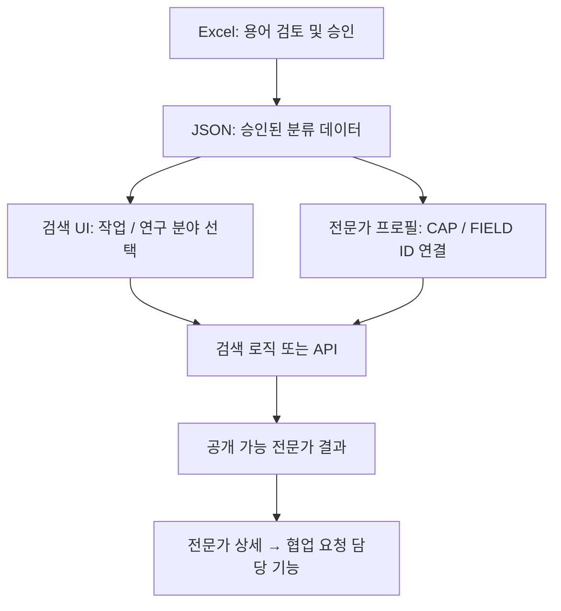

# WHAT THE LAB | 전문가 탐색 분류체계 적용 가이드

> **문서 범위:** WHAT THE LAB 전문가 탐색(C 영역)에서 분류체계 v3.0.0-rc1을 적용하는 방법  
> **상태:** 설계 및 개발 가이드 / 운영 배포 승인 전  
> **권장 Git 위치:** `docs/taxonomy/README.md` (저장소 루트의 기존 `README.md`를 덮어쓰지 마세요.)  
> **관련 산출물:** `WHAT_THE_LAB_Taxonomy_v3.xlsx`, `WHAT_THE_LAB_Taxonomy_v3_Developer_Package.zip`, `WHAT_THE_LAB_분류체계_실서비스_적용가이드.pdf`

## 0. 30초 요약

**분류표는 전문가 검색창에 자동으로 붙는 파일이 아닙니다.** Excel은 용어를 관리·검토하는 원본이고, 승인된 JSON/DB를 UI 및 서버에 연결해야 합니다.



**이번에 결정한 원칙**

- **수행 역량(CAP):** 전문가가 무엇을 할 수 있는지 (예: `CAP023` 객체 탐지·위치 추정)
- **연구 분야(FIELD):** 어떤 학문·연구 분야인지 (예: `FIELD011` 의료영상·영상의학)
- **도구(TOOL):** 무슨 언어/프레임워크를 쓰는지 (예: Python, PyTorch). 도구만 보고 CAP 역량을 자동 부여하면 안 됨
- **화면 필터 그룹(UG):** 이용자에게 보여주는 쉬운 큰 범주 (예: `UG04` 이미지·영상 분석). UI 그룹 선택은 여러 CAP ID에 대한 **OR 검색**
- **검색 동의어:** 검증된 `PREFERRED`/`EXACT`만 ID 자동 연결. `RELATED`는 **후보 제안**만
- **기술과 연구 분야:** 두 축을 함께 선택하면 기본 **AND**; 각 축의 다중 선택은 기본 **OR**

> **중요:** v3 데이터의 분류 항목과 UI 그룹은 대부분 `pending_review`입니다. 운영 환경에서 그대로 전체 공개하거나, 기계적으로 상태를 `active`로 일괄 변경하지 마세요. 시연 화면의 인물·성과도 가상 데이터입니다.

---

## 1. 실제 데이터 구성

현재 v3.0.0-rc1에 포함된 항목은 아래와 같습니다.

| 파일 | 항목 수 | 역할 |
|---|---:|---|
| `capabilities.json` | 80 | 수행 기술 세부 항목, `CAP001`~`CAP080` |
| `research-fields.json` | 83 | 연구 분야 세부 항목, `FIELD001`~`FIELD083` |
| `categories.json` | 21 | 수행 기술 대분류 11개, 연구 분야 대분류 10개 |
| `tools.json` | 32 | 프로그래밍 언어·모델·프레임워크 등 보조 정보 |
| `search-aliases.json` | 632 | 표준명 및 정확 동의어, `auto_match` 정책 포함 |
| `related-search-terms.json` | 89 | 관련 검색어. 자동 역량 인증 불가 |
| `ui-filter-groups.json` | 11 | 검색 화면에 표시할 상위 필터 |
| `ui-group-members.json` | 80 | UI 그룹과 CAP 세부 기술 간 연결 |
| `search-rules.json` | 24 | 검색·표시 정책 |
| `golden-test-cases.json` | 33 | 검증할 대표 검색 시나리오 |
| `postgres_schema.sql` | - | DB 구조 **초안** (바로 운영 반영 금지) |
| `taxonomy.schema.json` | - | JSON 구조 검증용 기본 스키마 |
| `validate_taxonomy.py` | - | ID·관계·동의어 정적 검증 |

### 1.1 각 데이터가 맡는 역할

| 질문 | 어느 파일? | ID/필드 예시 |
|---|---|---|
| 어떤 작업을 맡길까? | `capabilities.json` | `CAP023`, `label_ko`, `category_id` |
| 어떤 분야인가? | `research-fields.json` | `FIELD011`, `label_ko` |
| 처음에는 큰 범주만 볼까? | `ui-filter-groups.json` | `UG04`, `show_default` |
| 큰 범주 선택 시 어떤 CAP를 찾나? | `ui-group-members.json` | `UG04` → 복수 `CAP...` |
| '객체 검출'을 입력하면? | `search-aliases.json` | `term_id`, `relation`, `auto_match` |
| 유사한 단어는 어떻게 처리하나? | `related-search-terms.json` | `RELATED`, `suggest_only` |
| 전문가는 PyTorch를 사용할까? | `tools.json` + 별도 전문가-도구 연결 | `TOOL...` (역량 자동 부여 X) |

### 1.2 용어의 차이

- **CAP023 객체 탐지·위치 추정:** 이미지에서 객체의 종류와 위치를 찾음.
- **CAP024 이미지 분할·영역 추출:** 이미지에서 픽셀/영역 경계를 나눔. CAP023과 같지 않음.
- **CAP032 문서 검색·정보 검색:** 관련 문서를 찾음.
- **CAP052 검색증강생성·RAG 구축:** 검색 정보를 생성형 AI 답변에 활용하는 시스템을 만듦. 단순 문서 검색과 구분.
- **CAP044 시계열 패턴 분석 / CAP045 시계열 미래값 예측:** 분석과 미래값 예측은 별개.

## 2. 연구자 관점의 실제 이용 흐름

1. `/experts`에서 검색어를 입력하거나 **무엇을 맡길까요?**의 큰 기술 그룹을 선택합니다.
2. 필요하다면 세부 CAP 기술을 선택합니다.
3. **어떤 분야인가요?**에서 연구 분야 FIELD를 선택합니다. 분야 필터는 필요할 때만 사용해도 됩니다.
4. 브라우저가 선택한 CAP/FIELD ID를 URL에 반영하고, 검색 API에 전달합니다.
5. 서버가 **공개 가능한 전문가**만 대상에 넣어 기술·분야 조건을 적용합니다.
6. 사용자에게 정확하게 일치한 결과와 관련 기술 제안을 구분해 보여줍니다.
7. 전문가 프로필을 열고 기술·연구 경험·협업 조건을 확인합니다.
8. 협업 요청 기능으로 선택한 전문가 ID를 전달합니다(요청 생성·보관·권한 관리는 담당자와 계약 필요).

**예시**: 연구자가 `객체 검출`을 검색하면, 검증된 EXACT 매핑을 통해 `CAP023`으로 연결합니다. 이후 해당 CAP를 **직접 등록한 공개 전문가**를 검색합니다. `의료영상` 분야를 추가 선택하면 FIELD 조건도 적용합니다. `CAP023`만 있다고 해서 의료영상 프로젝트 경험까지 있다고 가정하지 않습니다.

## 3. 확정된 시연 화면과의 연결 위치

이 저장소에서 확인한 파일을 기준으로 작성했습니다. **시안 코드는 운영 기능이 아닙니다.** 실제 구현 범위는 팀의 최신 브랜치를 기준으로 재확인하세요.

| 위치 | 현재 역할 | 적용할 변경 |
|---|---|---|
| `frontend/src/app/experts/page.tsx` | 전문가 찾기 진입 페이지 | 승인된 분류표 데이터 공급 또는 API 조회 |
| `frontend/src/components/expert-browser.tsx` | 문자열 기반 필터·URL 동기화 | CAP/FIELD ID 필터로 전환, 기존 링크 호환 |
| `frontend/src/components/expert-card.tsx` | 전문가 카드 | CAP/FIELD ID를 표준 표시명으로 변환 |
| `frontend/src/components/expert-detail.tsx` | 상세 화면 | 검증 상태·연구 분야·협업 가능 조건 구분 |
| `frontend/src/lib/experts.ts` | **시연용 가상 전문가** | 데이터 구조 참고만; 운영 DB로 복제 금지 |
| `frontend/src/components/expert-request-dialog.tsx` | 시연용 협업 요청 | 전문가 ID와 선택 프로젝트 ID 전달 계약 협의 |
| `frontend/src/app/experts/[slug]/page.tsx` | 상세 주소 | 기존 slug 호환, 실제 공개 권한 검증 |

**권장 추가 경로** (아직 생성되어 있다고 가정하지 않음):

```text
repo/
├── docs/
│   └── taxonomy/
│       └── README.md                        # 이 문서
├── data/
│   └── taxonomy/
│       └── v3.0.0-rc1/                      # 원본 승인 전 스냅샷
│           ├── capabilities.json
│           ├── research-fields.json
│           ├── ui-filter-groups.json
│           ├── ui-group-members.json
│           ├── search-aliases.json
│           └── ...
└── frontend/
    └── src/
        ├── lib/
        │   └── taxonomy/                     # 타입/로드/검색 유틸
        └── components/
            └── expert-browser.tsx
```

> **주의:** Next.js에서 JSON을 정적으로 import할 때는 실제 파일 위치와 빌드/서버 경계를 고려해야 합니다. 위 구조는 권장 폴더안으로, 실제 import 경로는 팀의 모노레포 구성에 맞게 정해야 합니다.

## 4. 1차 구현: 실제 백엔드 없이 Mock Data로 이해하기

### 4.1 샘플 전문가 데이터 (반드시 예시로만 사용)

```ts
// 가상 시연 데이터. 실서비스 전문가 이력이나 인증 정보가 아님.
type ExpertDemo = {
  id: string;
  name: string;
  isPublic: boolean;
  capabilityIds: string[];
  experienceFieldIds: string[];
  collaborationFieldIds: string[];
  toolIds: string[];
};

const demoExperts: ExpertDemo[] = [
  {
    id: "demo-001", name: "가상 전문가 A", isPublic: true,
    capabilityIds: ["CAP023", "CAP024"],
    experienceFieldIds: ["FIELD011"],
    collaborationFieldIds: ["FIELD011", "FIELD002"],
    toolIds: []
  },
  {
    id: "demo-002", name: "가상 전문가 B", isPublic: true,
    capabilityIds: ["CAP032", "CAP052"],
    experienceFieldIds: ["FIELD068"],
    collaborationFieldIds: ["FIELD068"],
    toolIds: []
  }
];
```

### 4.2 CAP/FIELD 조건으로 필터하기

```ts
type Criteria = { capabilityIds: string[]; fieldIds: string[] };

function filterDemo(experts: ExpertDemo[], criteria: Criteria) {
  return experts.filter((e) => {
    if (!e.isPublic) return false;
    const capabilityOk = criteria.capabilityIds.length === 0 ||
      criteria.capabilityIds.some((id) => e.capabilityIds.includes(id));
    const fieldOk = criteria.fieldIds.length === 0 ||
      criteria.fieldIds.some((id) => e.experienceFieldIds.includes(id));
    return capabilityOk && fieldOk;
  });
}

// 기술 복수 선택 OR, 연구 분야 복수 선택 OR,
// 기술 + 연구 분야 AND
const result = filterDemo(demoExperts, {
  capabilityIds: ["CAP023"],
  fieldIds: ["FIELD011"]
});
```

### 4.3 UI 큰 그룹에서 세부 기술로 확장

```ts
import groupMembers from "./ui-group-members.json";

export function expandUiGroup(groupId: string): string[] {
  return groupMembers
    .filter((m) => m.group_id === groupId)
    .map((m) => m.capability_id);
}

// '이미지·영상 분석' UG04 → 구성 CAP ID의 집합
// 그룹을 선택했다고 전문가가 모든 기술을 보유한 것은 아님
```

**실수 방지:** `TOOL...`을 `capabilityIds`에 넣지 말 것. 문자열(`"객체 검출·분할"`)을 운영 ID처럼 저장하지 말 것. `related-search-terms.json`으로 정확 매칭한 것처럼 표시하지 말 것.

## 5. 2차 구현: 검색 URL과 API 계약

아래 엔드포인트는 **제안 명세**입니다. 현재 배포된 실제 API라고 주장하는 것이 아닙니다.

```http
GET /api/v1/taxonomy/capabilities?status=active
GET /api/v1/taxonomy/research-fields?status=active
GET /api/v1/taxonomy/ui-groups?status=active
GET /api/v1/experts?capabilityIds=CAP023&fieldIds=FIELD011&page=1&pageSize=12
GET /api/v1/experts/{expertId}
```

**권장 응답 예시** (가상 데이터):

```json
{
  "data": [
    {
      "id": "demo-001",
      "displayName": "가상 전문가 A",
      "capabilityIds": ["CAP023", "CAP024"],
      "experienceFieldIds": ["FIELD011"],
      "verificationStatus": "self_declared"
    }
  ],
  "pagination": { "page": 1, "pageSize": 12, "total": 1 },
  "taxonomyVersion": "3.0.0"
}
```

운영 API는 서버에서 인증/권한을 검증하고 공개 가능 프로필만 반환해야 합니다. 협업 요청/프로젝트 정보는 별도 서비스 계약을 따릅니다. 기존 시안 URL `?q=`, `?skill=`, `?task=`, `?domain=`의 호환 정책은 팀 합의 후 전환하세요.

## 6. 3차 구현: 데이터베이스와 운영

`postgres_schema.sql`은 구조 참고용이며, **검토되지 않은 운영 마이그레이션 스크립트가 아닙니다.** 실제 테이블명·전문가 ID 자료형·FK, RLS/RBAC, 배포 마이그레이션 및 롤백 전략을 확정해야 합니다.

관계는 다음과 같이 구분합니다.

```text
[분류 카테고리] → [CAP/FIELD 세부 항목] ← [검색 동의어]
                              ↑
                  [전문가-기술 연결]
                              ↑
                         [전문가 프로필]
                              ↓
                     [전문가-연구 분야 연결]
```

전문가-기술 연결에는 `verification_status`(`self_declared`, `in_review`, `verified`, `rejected`)와 증빙 접근 제한이 필요합니다. 전문가-연구 분야 연결에는 `experience`(경험 분야)와 `collaboration_interest`(협업 희망 분야)를 구분하는 것이 좋습니다.

## 7. 검색 동의어와 추천어 적용 규칙

1. 사용자 입력을 Unicode 정규화(NFKC)하고 대소문자·앞뒤 공백을 정리합니다.
2. 승인된 `PREFERRED` 및 `EXACT`를 먼저 확인합니다.
3. `auto_match=no`이거나 다의적 약어이면 사용자가 구체적 의미를 고르도록 합니다.
4. `RELATED`는 관련 기술 제안 영역에만 사용합니다. 자동으로 해당 기술 보유를 인정하지 않습니다.
5. 정확 일치와 관련 추천의 출처 및 표시 방식을 구분합니다.
6. 0건일 때는 조건 해제와 관련 검색어를 제공하지만, 자격이 없는 전문가를 임의로 추가하지 않습니다.

## 8. 개발·검증 실행 절차

**입력:** v3 개발 패키지 ZIP을 내려받아 로컬에서 압축 해제한 상태를 가정합니다.

```bash
# taxonomy 파일이 있는 폴더에서 실행
python validate_taxonomy.py
python test_search_smoke.py
```

`validate_taxonomy.py`는 ID 중복·참조·동의어 충돌 등을 검사합니다. `test_search_smoke.py`는 포함된 대표 검색어를 대상으로 검사합니다. **이 테스트는 실제 Next.js/백엔드 통합테스트를 대체하지 않습니다.**

프론트엔드 코드 적용 후에는 저장소의 개발 환경에서 빌드 및 실행 확인이 필요합니다.

```bash
cd frontend
npm install
npm run dev
# 별도 터미널에서
npm run build
```

`npm install`은 팀에서 승인한 lockfile 및 패키지 매니저(`npm ci`, pnpm 등)에 맞춰 조정하세요. 이 명령은 README 예시이며, 현 브랜치에서 실제로 실행 검증한 것은 아닙니다.

### 반드시 검증할 사례

- [ ] `객체 검출`이 **CAP023**에 연결되는가?
- [ ] `이미지 분할`은 **CAP024**로 별도 취급되는가?
- [ ] `UG04`를 누르면 여러 세부 CAP 기술이 OR로 검색되는가?
- [ ] `CAP023` + `FIELD011`은 두 축을 AND로 적용하는가?
- [ ] `RELATED` 검색어가 임의로 기술 보유 사실이 되지 않는가?
- [ ] 비공개·탈퇴·정지 전문가가 검색 결과에서 제외되는가?
- [ ] 검증받지 않은 기술이 `검증됨`으로 표시되지 않는가?
- [ ] 필터 URL 새로고침·뒤로가기·기존 링크가 작동하는가?
- [ ] 결과 0건·로딩·서버 오류·모바일·키보드 사용을 확인했는가?
- [ ] 시연용 가상 전문가/성과가 운영 배포 데이터에 포함되지 않았는가?

## 9. 브랜치·PR 협업 순서

1. 팀의 `develop` 최신 코드를 가져오고 팀 규칙에 맞게 기능 브랜치를 생성합니다. 예: `feat/expert-taxonomy`.
2. **첫 PR:** 분류표 데이터/검증 스크립트/문서만 넣어 리뷰합니다. 팀 승인이 필요한 용어는 `pending_review` 유지.
3. **둘째 PR:** 전문가 Mock Data 모델과 CAP/FIELD 필터 연결. UI 디자인은 유지.
4. **셋째 PR:** 백엔드 API 계약, DB 연결, 검색 권한 검사 및 통합 테스트.
5. 리뷰에서 ID 재사용/이력 변경/운영 공개 범위/롤백 계획을 확인합니다.

**PR 체크:** 무엇이 바뀌었는지, 데이터 버전, 기존 링크 영향, 화면 캡처, 테스트 명령과 결과, 롤백 방법, 미해결 위험을 기록하세요.

## 10. 출시 전 승인 조건

- [ ] 기술/연구 분야의 의미·명칭을 분야별 연구자와 검토함
- [ ] 정확 동의어·관련어·약어 충돌을 점검함
- [ ] 승인 항목만 `active`로 전환하고 원본 버전을 보존함
- [ ] 실제 전문가 프로필 데이터의 동의·검증·공개 상태를 확인함
- [ ] 서버 권한 검사 및 개인정보/검색 로그 관리 기준을 승인함
- [ ] API/DB 마이그레이션·롤백을 검토함
- [ ] 실제 검색 품질·성능·모바일/접근성 테스트 통과 기록을 보유함
- [ ] 시연용 인물·가상 평가·가상 성과를 운영에서 제거함
- [ ] 운영 책임자·변경 승인자·이슈 대응 경로를 확정함

**출시 판단:** 현재 제공된 v3.0.0-rc1은 자동 정적 검증을 통과한 **검토 후보**이며, 실제 배포 승인 상태가 아닙니다.

## 11. FAQ

**Q. 화면을 전면 바꿔야 하나요?**  
A. 아니요. 시연 UI를 유지하고 드롭다운 선택지를 JSON/ID 기반으로 연결하면 됩니다. 다만 필터 내부의 계층 탐색·검색 편의성은 사용자 테스트에 따라 보완할 수 있습니다.

**Q. 키워드 80개를 모두 화면에 보여줘야 하나요?**  
A. 아니요. UI 그룹 11개 중 초기 표시 7개(`show_default=true`)를 우선 보여주고 나머지는 확장하는 설계 초안입니다. 정확한 개수는 사용성 테스트로 확정합니다.

**Q. 엑셀을 Git에 올리면 검색이 자동으로 되나요?**  
A. 아닙니다. 승인된 JSON을 코드나 DB에 연결하고, 실제 검색 로직 또는 API가 ID를 비교해야 합니다.

**Q. v2 기술 ID를 v3에 그대로 옮겨도 될까요?**  
A. 자동 이관 금지. `migration-v2-review.json`은 **후보 목록**이므로 의미 검토 후 승인해야 합니다.

**Q. 이 README를 루트에 올리면 되나요?**  
A. 기존 저장소 루트 `README.md`가 있으므로 `docs/taxonomy/README.md`를 권장합니다. 루트 README에는 이 문서로 이동하는 링크만 추가하세요.

## 12. 용어·참조 문서

- `CAP`: 수행 기술(Capability), `FIELD`: 연구 분야, `TOOL`: 도구, `UG`: UI 필터 그룹
- `EXACT`: 동일 개념의 승인 동의어, `RELATED`: 관련어 제안
- `RC`: Release Candidate(배포 전 검토 후보), `Mock Data`: 기능 검증용 가상 데이터
- W3C SKOS: https://www.w3.org/TR/skos-reference/
- OECD Frascati Manual: https://www.oecd.org/en/publications/2015/10/frascati-manual-2015_g1g57dcb.html
- W3C WCAG 2.2: https://www.w3.org/TR/WCAG22/

---

**현재 가이드의 기준 버전:** v3.0.0-rc1  
**주의:** 이 문서와 개발 패키지는 구현 가이드 및 검토 자료입니다. 실제 코드 변경, 운영 API 연동, DB 마이그레이션 또는 배포가 수행되었다는 의미가 아닙니다.

